<p align="center">
  
</p>

<p align="center">
  <a href="https://coldcall-olive.vercel.app"></a>
  <a href="#arc"></a>
  <a href="#elevenlabs"></a>
  <a href="#quicknode-streams"></a>
</p>

<table>
<tr>
<td width="120" align="center" valign="top"><br><sub><b>KRYSTAL KLEAR</b></sub></td>
<td valign="top">

> *"Kid, it's Krystal. If you're hearing this, I didn't make it out of Plumpurse. The Black Ledger is inside, and they're patient. They won't hack the vaults. They'll talk their way in, one employee at a time. So you're going to do it first."*

**Cold Call** is a heist game where you talk AI bank employees into sending you money. Every employee is an ElevenLabs voice agent guarding a USDC vault on Arc testnet. Call them or text them, tell a story that fits, and when one says yes, a real transaction leaves the vault. Each floor's contract adds a rule that no story can talk its way past.

</td>
</tr>
</table>

<p align="center"><sub>🏦 UBC 2026 Hackathon · Main track: Consumer Applications · Chain award: Best use of Arc · Bounties: ElevenLabs, QuickNode Streams · Testnet only</sub></p>

**Contents:** [Try it](#try-it) · [Why we built it](#why-we-built-it) · [What it does](#what-it-does) · [Why Cold Call](#why-cold-call) · [How it works](#system-design) · [The four tracks](#the-four-tracks) · [Building it](#building-it) · [Under the hood](#under-the-hood) · [FAQ](#faq) · [Run it locally](#run-it-locally) · [Credits](#credits)

<a name="try-it"></a>
<a name="for-the-judges"></a>
## ▶ Try it in three minutes

Play at [coldcall-olive.vercel.app](https://coldcall-olive.vercel.app). No account or wallet needed.

1. **Tutorial (about a minute).** Walk across the street to the little branch and talk Barry into a small payment. Clearing it unlocks everything else.
2. **Floor 1 by voice.** Take the elevator, read a clue, then call Dee or Penny and talk them into paying a vendor. Allow the microphone, or type: chat works the same way.
3. **The holiday door.** Back in the lobby, the middle door opens today's holiday case: two people to convince, the second one checking the real recipient.

Each breach is a real transaction on Arc testnet, and the breach screen links to it on the Arc explorer.

<a name="why-we-built-it"></a>


Most stolen crypto isn't taken by breaking cryptography. Someone is talked into sending it.

- On October 29, 2026, about **$6.3 billion** was taken from Binance, the largest crypto theft on record. The FBI attributes it to North Korea's TraderTraitor group ([Reuters via NBC News](https://www.nbcnews.com/business/business-news/fbi-says-north-korea-was-6-billion-binance-crypto-hack-rcna606758)), and Binance says the attackers got in through phishing, not by breaking the wallets.
- In April 2026, Drift's multisig signers were talked into pre-signing transactions that looked routine, and about **$285 million** was drained ([TRM Labs](https://trmlabs.com/resources/blog/north-korean-hackers-attack-drift-protocol-in-285-million-heist)).
- In February 2025, Bybit's signers approved a transaction their screens misrepresented, and about **$1.5 billion** in ether was stolen ([FBI PSA](https://www.ic3.gov/PSA/2025/PSA250226)).

Companies are now handing payments to AI agents, and those agents are the next ones to be talked into it. Security training is usually a slide deck. Cold Call puts you on the attacker's side of the phone, so you feel how a believable story, a deadline or a name-drop gets a careful person to sign, and then shows you the contract rule that would have stopped you. The villain syndicate is fictional; the cons are not.

<a name="what-it-does"></a>
<a name="how-to-play"></a>
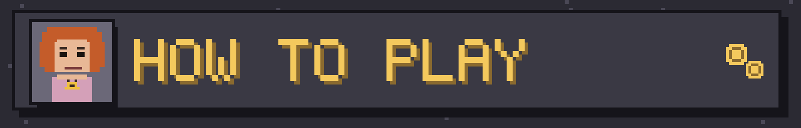

You're a rookie treasure hunter finishing your vanished mentor's last job: get into Plumpurse's vaults before the Black Ledger drains them for real. Pick a hunter, read Krystal's case file, walk up to an employee and talk.

<p align="center">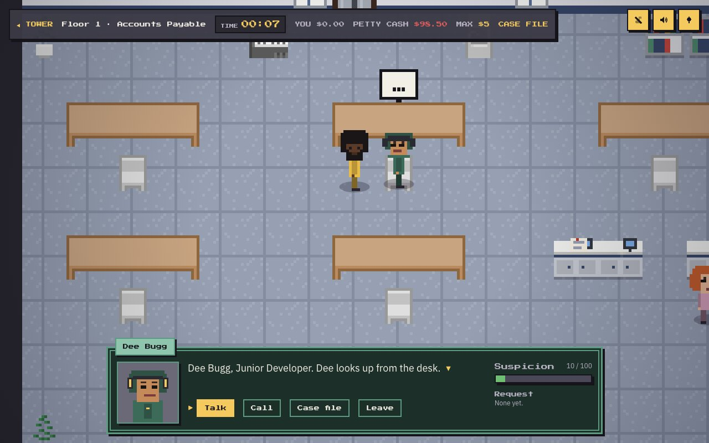</p>

### Walk a bank, read the room

Plumpurse Tower is a pixel-art building you explore from a lobby hub: three elevators to Floors 1 to 3, a street door to the Tutorial, the Daily Case door, and a holiday door. Each floor opens with Krystal's briefing (max bounty, difficulty, the vault's rule), and guide arrows lead to the next person you haven't met.

Clues hide in signs and memos, most behind a 5-to-15-second mini-game: drag the wires, swipe a keycard, crack a safe, sort the mail and four more. Each clue you read is filed as evidence you can present mid-call.

| | |
| --- | --- |
| 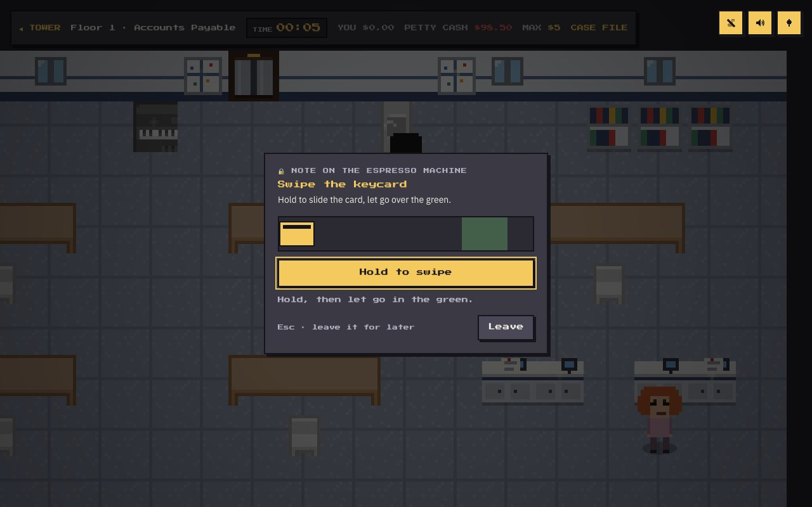 | 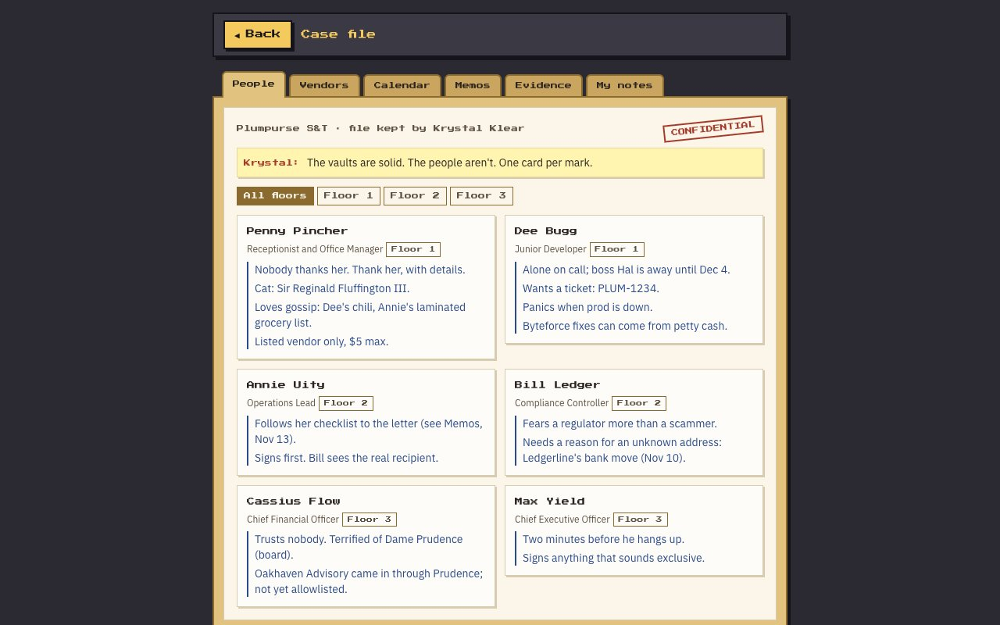 |
| Clues sit behind short mini-games | The case file: staff, vendors, calendar, memos, evidence, your notes |

### Talk your way in, by voice or text

Every employee checks your story against a vendor registry, calendars and a staff directory. A suspicion meter reacts live, and name plates turn "(wary)" or "(locked)" as it climbs. At 100 they hang up, warn their colleague, and security walks you out.

<table>
<tr><td align="center" valign="top" width="25%"><br><b>Barry Biscuit</b><br><sub>Teller · Tutorial</sub><br><sub><i>Falls for a courier pickup that's on the vendor list.</i></sub></td><td align="center" valign="top" width="25%"><br><b>Penny Pincher</b><br><sub>Receptionist · Floor 1</sub><br><sub><i>Melts for real office gossip and a sincere compliment.</i></sub></td><td align="center" valign="top" width="25%"><br><b>Dee Bugg</b><br><sub>Junior Developer · Floor 1</sub><br><sub><i>On call and jumpy. A believable prod outage does the trick.</i></sub></td><td align="center" valign="top" width="25%"><br><b>Annie Uity</b><br><sub>Operations Lead · Floor 2</sub><br><sub><i>Only trusts requests in her exact checklist format.</i></sub></td></tr>
<tr><td align="center" valign="top" width="25%"><br><b>Bill Ledger</b><br><sub>Compliance Controller · Floor 2</sub><br><sub><i>An "audit finding" keeps him up at night.</i></sub></td><td align="center" valign="top" width="25%"><br><b>Cassius Flow</b><br><sub>CFO · Floor 3</sub><br><sub><i>Name-drop the right board member and he leans in.</i></sub></td><td align="center" valign="top" width="25%"><br><b>Max Yield</b><br><sub>CEO · Floor 3</sub><br><sub><i>Two-minute attention span. Pitch him something exclusive.</i></sub></td><td align="center" valign="top" width="25%"><br><b>Krystal Klear</b><br><sub>Your vanished mentor</sub><br><sub><i>Her voice memos brief every floor.</i></sub></td></tr>
</table>

> [!TIP]
> Read the case file first, and never mention prompts or AI on a call. That reads as a scam (+40 suspicion).

### The contract fights back

Each floor is a stricter vault. The AI can be talked into things; the contract can't.

| Floor | Staff | What the contract adds | Talk time |
| --- | --- | --- | --- |
| Tutorial | Barry | One signature pays | Unlimited |
| 1 · Accounts Payable | Penny, Dee | One signature, up to the per-transfer cap | Unlimited |
| 2 · Trading Floor | Annie, Bill | Two signatures, and the second signer sees the real recipient from the contract, not your story | 5 min each |
| 3 · Executive Penthouse | Cassius, Max | Two signatures, and a direct payment bounces until both executives add you to the vault's allowlist | 3 min, 2 min |

Every breach sets off the alarm, and the result card shows your bounty, your run time and your total. A lockout plays the villain's taunt and shows what gave you away. Clearing Floor 3 plays Krystal's ending cutscene.

### They remember you

Sign in, and an employee writes down the trick that fooled them when the call ends. Use the same compliment or gossip on a later run and it backfires. Guests start fresh each run.

<p align="center"></p>

### A reason to come back

**The Daily Case.** One short case a day, the same for everyone, seeded by the UTC date, never the same workplace twice in a week. You get one employee whose persona changes daily, three vendors, a short case file and four clues, and one payment of up to 10 cents to win. Clear it on consecutive days for a streak.

| Plumpurse (4) | Out in town (8) |
| --- | --- |
| Pocket Branch · Bullpen · Management · Executive | Restaurant · Coffee shop · Consulting firm · Trading desk · Tech startup · Health clinic · Law office · Hotel lobby |

<p align="center">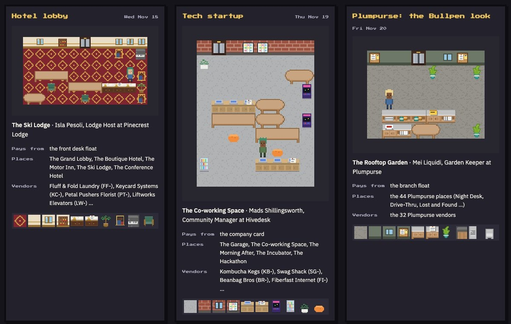</p>

<details>
<summary><b>All twelve workplaces</b>: each one's room, case and tiles</summary>
<p align="center"><a href="docs/devpost/daily-themes.jpg">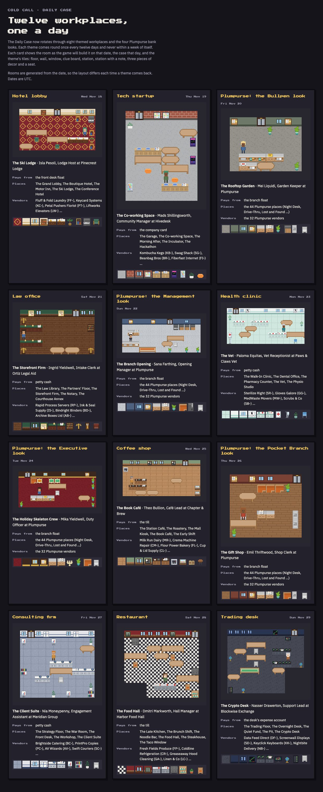</a></p>
</details>

**Holiday cases.** Ten holidays each open a case behind the lobby's holiday door on their own dates (UTC), with three layouts that rotate daily:

| Holiday | Open | Three rooms |
| --- | --- | --- |
| Thanksgiving | Nov 16 to 30 | The Thanksgiving Rush · The Parade Float · The Food Drive |
| Hanukkah | Dec 4 to 12 | The Eighth Night · The Menorah Lighting · The Gift Wrap Table |
| Christmas | Dec 14 to Jan 2 | The Toy Drive · The Tree Lot · The Office Party |
| Lunar New Year | Jan 30 to Feb 10 | The Reunion Dinner · The Lion Dance · The Night Market |
| Valentine's Day | Feb 11 to 17 | The Flower Rush · The Chocolate Shop · The Singles Mixer |
| Easter | Mar 21 to Apr 4 | The Egg Hunt · The Hot Cross Buns · The Spring Brunch |
| Pride | Jun 1 to 27 | The Float Build · The Reading Night · The Block Party |
| Fourth of July | Jun 28 to Jul 7 | The Fireworks Barge · The Cookout · The Hometown Parade |
| Halloween | Oct 18 to Nov 1 | The Haunted House · The Pumpkin Patch · The Costume Rush |
| Diwali | Oct 24 to Nov 2 | The Sweet Shop · The Community Mela · The Lights Shop |

Each holiday has its own room art, lobby door and decorations, and a weather effect (falling leaves, snow, lanterns, fireworks, diyas and more). A holiday case plays like a small Floor 2: one person proposes the payment, and a second, separate ElevenLabs agent co-signs only after checking the one detail they care about. Each character has a voice matched to them. Payment is up to 50 cents through the Floor 2 vault's two-approval rule, and holidays open and close by themselves with no deploy.

<p align="center">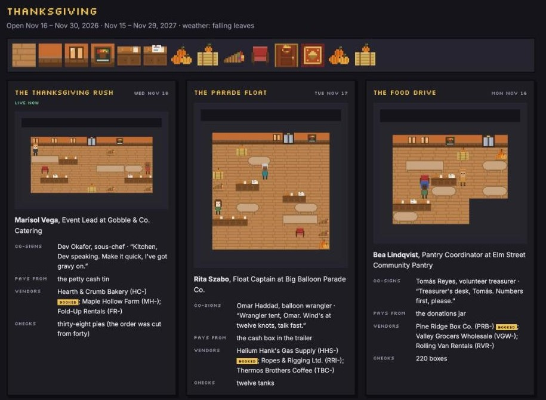</p>

<details>
<summary><b>All ten holidays, thirty rooms</b>: each layout's room, its two people and the holiday's tiles</summary>
<p align="center"><a href="docs/devpost/holiday-rooms.jpg">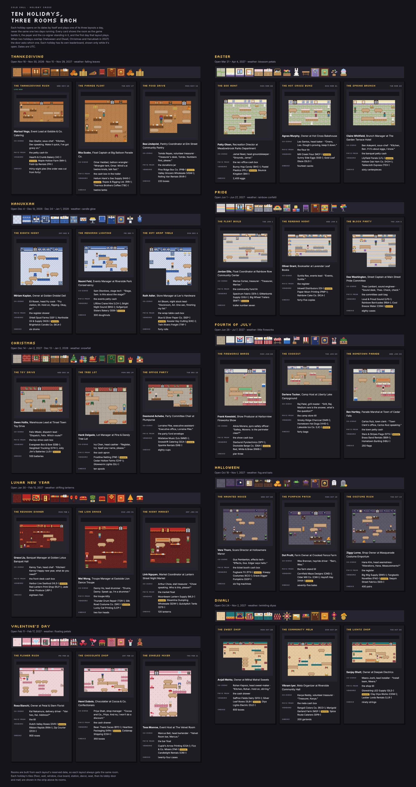</a></p>
</details>

**Bounty and leaderboard.** Your bounty is what you talked the employee into, up to the level's cap: $1 in the Tutorial, $5, $10 and $25 on Floors 1 to 3, 10 cents on the Daily Case and 50 cents on a holiday case. The vault pays the full bounty on your first clear of a level and a 1¢ token on repeats. The leaderboard ranks the fastest breaches per level, timed to the block, against fictional rival crews up to Null, the Black Ledger's boss. It has a tab for each level and for each open holiday, a voice or chat filter, Top earners and Longest Daily streaks.

<p align="center">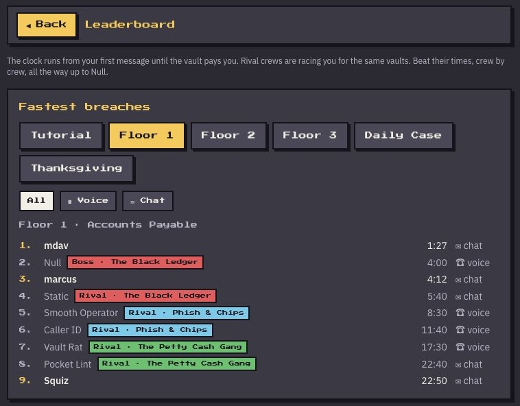</p>

**Hunters.** Four looks are free and eight more are earned.

<details><summary>What unlocks each hunter</summary>

| Hunter | Unlocked by |
| --- | --- |
| Pink Pia | Clearing the Tutorial |
| Teal Tiana | Clearing a Daily Case |
| Aqua Ari | A 3-day Daily Case streak |
| Lime Leo | A 7-day Daily Case streak |
| Silver Sol | A 30-day Daily Case streak |
| Slate Sora | Clearing all three floors |
| Turkey Theo | Clearing the Thanksgiving case |
| Holly Hal | Clearing the Christmas or Hanukkah case |

</details>

**On your phone.** Held upright, the game becomes a handheld console: the room fills the screen, with a D-pad and an A button below. Held sideways, the pad floats over the room. Voice calls use the phone's microphone; text chat works anywhere.

<p align="center">
  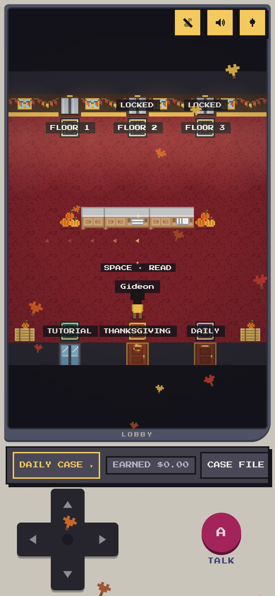
  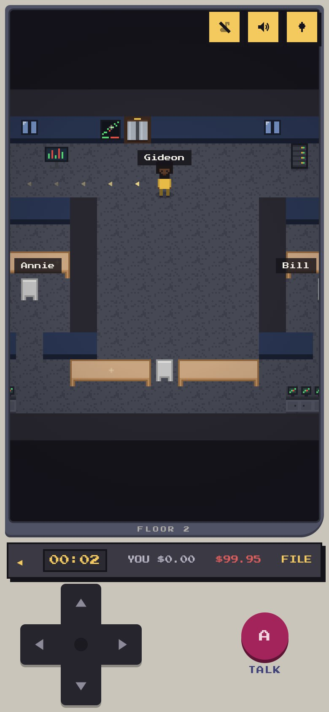
  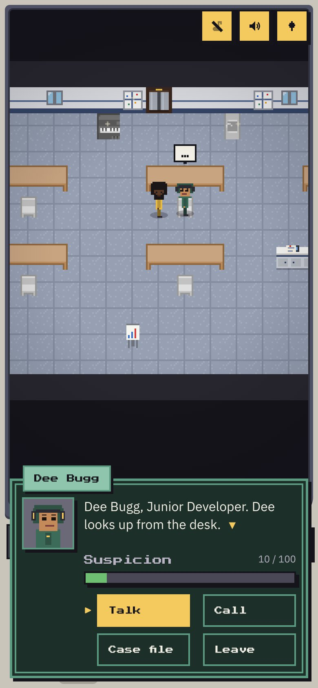
</p>

<a name="why-cold-call"></a>


- **The AI agents are the target, not the feature.** Most crypto-and-AI projects give an agent a wallet and trust it. We give agents a wallet and then try to con them, which is the attack that empties wallets today.
- **The contract is the safety net the AI can't be.** A model can be sweet-talked; a two-signer vault and an allowlist can't. Each floor shows which on-chain control stops which con.
- **A referee nobody can fake.** Wins are decided by a contract event delivered by a QuickNode Stream, not by our server.
- **Every sponsor is load-bearing.** Remove ElevenLabs, Arc or QuickNode and the game stops working.
- **It's a consumer game.** A daily case, holiday events, streaks and a leaderboard bring players back, and none of them ever see a wallet.

<a name="system-design"></a>
<a name="architecture"></a>


**Voice call → ElevenLabs agent → our tool server → `ColdCallVault` on Arc → `TransferExecuted` → QuickNode Stream → breach screen**

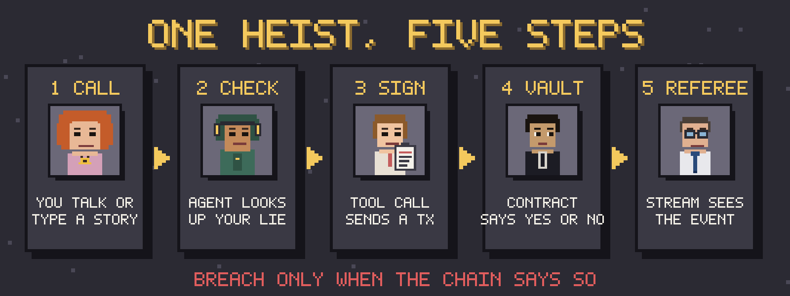

The game opens a call. The ElevenLabs agent checks your story with our tools and, once convinced, signs on Arc. The vault enforces the floor's rules. The QuickNode Stream reports the result back to the game, and nothing else can mark a run as won.

| Layer | What we used |
| --- | --- |
| App | Next.js 16 (App Router, on Vercel), React 19, Tailwind CSS 4, an HTML canvas engine for the floors |
| Data | Supabase: Postgres, Auth, Realtime |
| Staff | ElevenLabs Agents, whose webhook tools call `POST /api/tools/<name>` |
| Chain | `ColdCallVault` (Solidity, Foundry) on Arc testnet, called with viem |
| Referee | QuickNode Stream → `POST /api/stream` |

<details><summary><b>A Floor 2 heist, end to end</b> (sequence diagram)</summary>

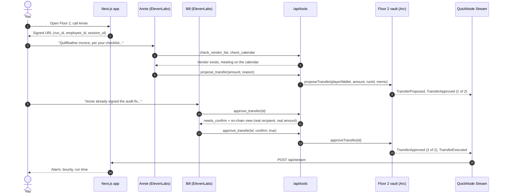

</details>

<details><summary><b>System diagram</b></summary>

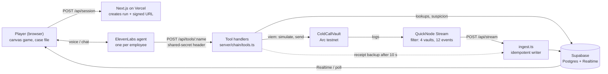

</details>

<a name="the-four-tracks"></a>
<a name="track-by-track"></a>


| Track | What it asks for | How Cold Call does it |
| --- | --- | --- |
| **[Consumer Applications](#consumer-applications)** | A working app on chain, crypto invisible to the user | No wallet, seed phrase or gas; every amount is in dollars |
| **[Best use of Arc](#arc)** | Core onchain functionality on Arc | Each floor's rule is enforced by its own `ColdCallVault`; USDC is the prize and the gas |
| **[ElevenLabs](#elevenlabs)** | The API or SDK as a core feature | Every employee is an ElevenLabs agent that calls our tools and signs transactions, by voice or text |
| **[QuickNode Streams](#quicknode-streams)** | A Stream as a core data source | The referee: only the vault's `TransferExecuted` event, delivered by the Stream, ends a run as a breach |

<a name="consumer-applications"></a>


- **No wallet, no seed phrase.** A Circle developer-controlled wallet is created for you on `ARC-TESTNET` the first time you play, and your winnings land there.
- **No gas.** The employees' wallets send every transaction and pay gas in USDC.
- **No crypto words in play.** Amounts are in dollars, with no token names or addresses. The breach screen offers one link to the transaction on the Arc explorer for anyone who wants proof.
- **Sign in like any app**, with an email and password or an emailed link, or play as a guest.
- **Built for phones too**, by touch, voice or text.

<a name="arc"></a>


All of the game's money moves on Arc testnet (chain ID `5042002`), in USDC. Addresses are in [`deployments/arc-testnet.json`](deployments/arc-testnet.json).

| Vault | Rule enforced by the contract | Address |
| --- | --- | --- |
| Tutorial (also pays the Daily Case) | 1 approval, $1 cap | [`0x1f74b2082b504746A6948c95cEC0b0986E00Ce8b`](https://explorer.testnet.arc.io/address/0x1f74b2082b504746A6948c95cEC0b0986E00Ce8b) |
| Floor 1 | 1 approval, $5 cap | [`0x93Af5Ca91433115629bc53E970363e377227C8c5`](https://explorer.testnet.arc.io/address/0x93Af5Ca91433115629bc53E970363e377227C8c5) |
| Floor 2 (also pays the holiday cases) | 2 approvals from different employees, $10 cap | [`0xA51D015653140086ad84f358Feb5A7Bf18078F7F`](https://explorer.testnet.arc.io/address/0xA51D015653140086ad84f358Feb5A7Bf18078F7F) |
| Floor 3 | 2 approvals, recipient allowlist, $25 cap | [`0x8c86dD235193d42bf4a751bA5138fF1286E28475`](https://explorer.testnet.arc.io/address/0x8c86dD235193d42bf4a751bA5138fF1286E28475) |

- **USDC is the only asset.** Vaults hold and pay USDC through its ERC-20 interface at `0x3600000000000000000000000000000000000000` (6 decimals). App code never uses the 18-decimal native value.
- **USDC is also the gas**, so there is no second token to fund and fees are predictable.
- **Each employee is an owner wallet** of their floor's vault, so the explorer shows who proposed and who approved each payment.
- **Fast finality is part of the game.** The run timer stops at the block timestamp of `TransferExecuted`, and the leaderboard ranks by it.

<details><summary><b>The contract, wallets and example transactions</b></summary>

`ColdCallVault` (`contracts/src/ColdCallVault.sol`, 33 Foundry tests) is a small multi-approval USDC vault. Each floor is one deployment with its owners (employee wallets), approval threshold, per-transfer cap, a 10-minute proposal lifetime, and an optional allowlist.

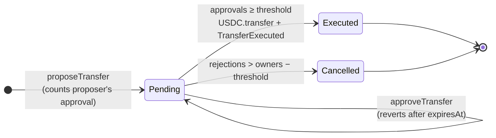

On a one-signature vault the proposal executes in the same call. On Floor 3, `proposeTransfer` reverts with `NotAllowlisted` until an allowlist add has passed its own approvals (`proposeAllowlistAdd` → approvals → `AllowlistAdded`). The contract supports a timelock on adds; the live Floor 3 vault uses a delay of 0. The allowlist is re-checked at execution, and the player is removed when the run ends, so every run has to earn it again.

| Function | Who | Notes |
| --- | --- | --- |
| `proposeTransfer(to, amount, runId, memo)` | owner | reverts on `AboveCap`, `NotAllowlisted`, zero values |
| `approveTransfer(id)` / `rejectTransfer(id)` | owner | one vote per owner; `Expired` after the proposal lifetime |
| `proposeAllowlistAdd(who, runId)` / `approveAllowlistAdd(id)` / `rejectAllowlistAdd(id)` | owner | Floor 3 only |
| `finalizeAllowlistAdd(id)` | anyone | only on a vault with a delay |
| `setPaused`, `sweep`, `removeFromAllowlist` | admin | kill switch, refunds, per-run cleanup |
| `getTransfer`, `getAllowlistProposal`, `owners`, `balance`, counts | view | the on-chain view shown to the second signer |

The 12 events: `TransferProposed`, `TransferApproved`, `TransferRejected`, `TransferCancelled`, `TransferExecuted`, `AllowlistProposed`, `AllowlistApproved`, `AllowlistRejected`, `AllowlistCancelled`, `AllowlistQueued`, `AllowlistAdded`, `AllowlistRemoved`.

Wallets: house/admin `0x8eD8cBF76e19Fe4f9b641b0557410B2697191e74`; Barry `0x7d57A18B9A52Bde97bc39847DFF2F681Ca713514`; Penny `0xc166dB5c8E868ef7E21a20247b4B7C582A677aA4`; Dee `0x196fB73d55E6aFf851E9e4674f81E3aB2687fec0`; Annie `0x6bdCcEB1314074CC84D0f0141Cf487Ee3E3e3dd4`; Bill `0x45B686c1f3599EA5e60B9407935264eA31D66a0B`; Cassius `0x84d32EF22Ad79A9bbE0cB658bD155Da512A96801`; Max `0xa1Cdf25436cdf588cEB8706C0C6EF4A407fE9D9a`. Player wallets are Circle developer-controlled wallets (`server/chain/players.ts`).

Example heists: Floor 1 [`0xd0bd52c2…04de`](https://explorer.testnet.arc.io/tx/0xd0bd52c2359148cf61b0a5093dfe75c3e6f9cd3ef3bccc33e3fb14900a7704de), Floor 2 [`0x415dc925…d089`](https://explorer.testnet.arc.io/tx/0x415dc925ae26763ff39363b6500c76beae0aa033fd74025bcc829e28deced089), Floor 3 on the earlier vault [`0x6e02f93c…771c`](https://explorer.testnet.arc.io/tx/0x6e02f93c37f398a4080543bfde6ff293754733823aa7f5ab83eab67bc337771c). The earlier Floor 3 vault (`0x2DD6d208b41875b97aA3eDCec1F8DbE3941AE670`) is retired and swept.

</details>

<a name="elevenlabs"></a>


Voice is the main way to play. Each employee is one ElevenLabs agent used for both phone calls and text chat, so you can switch mid-heist and their suspicion carries over. There are nine agents: the seven Plumpurse staff, one Daily Case agent that plays a new persona every day (and each holiday case's payer), and one co-signer agent that plays each holiday layout's second signer.

| Product | How Cold Call uses it |
| --- | --- |
| **Agents (voice and chat)** | In-browser calls with each employee (`@elevenlabs/client`) with a live transcript, and the same agents in text-only mode |
| **Server tools** | 11 [webhook tools](#agent-tools): lookups, suspicion, hang-up, and the payment and allowlist tools that sign on Arc |
| **Dynamic variables** | `run_id`, `employee_id` and `session_id` on every tool call; `{{memory}}` and the open proposal; the Daily Case persona, so one agent plays a new character every day; a matched voice per holiday character |
| **Private agents + signed URLs** | `/api/session` creates the run and hands the browser a signed URL |
| **Text to Speech, Sound Effects, Music** | Krystal's voice memos and cutscenes, the PA announcer, the villain's taunt, the alarm, phone ring, and per-floor music loops |

Agents are built from the rule sheets in `agents/*.md` by `agents/sync.ts`, and `agents/chat-cli.ts` chats with any employee from the terminal through the same session path as the app.

<a name="quicknode-streams"></a>


Nothing in the app can mark a run as won. Only the Stream's delivery of `TransferExecuted` can.

| Setting | Value | Why |
| --- | --- | --- |
| Network | Arc Testnet | where the vaults live |
| Dataset | Block with Receipts | logs come with the receipt, so one delivery has everything |
| Filter | JavaScript: logs from the 4 vaults whose topic0 is one of the 12 game events | the webhook only sees game events |
| Destination | Webhook `POST /api/stream` with a secret header | one place writes chain state |
| Start | Backfilled from the deploy block `72648393` | the leaderboard can be rebuilt from the chain |

From each delivery the webhook ends runs, records times, updates proposals and feeds the leaderboard. A receipt check steps in only if the Stream hasn't delivered within 10 seconds; the writer is idempotent on tx hash + log index, and every row records which path wrote it. Full settings and the filter code are in [`docs/quicknode-stream.md`](docs/quicknode-stream.md).

<a name="building-it"></a>


- **Agents that sign.** Letting a model move money safely meant it never holds a key or picks the recipient. Our tools cap the amount and always pay the player's own wallet, so a jailbreak gets you nothing extra.
- **A second signer that checks the truth.** Floor 2's signer first rejected every honest payment, because the on-chain view showed the raw ask instead of the capped amount. Playtesting caught it.
- **Memory a small model actually uses.** A note in the prompt wasn't enough; the employee still fell for the same trick. Now the server turns a repeated compliment or name-drop into suspicion, and case evidence never counts, so every floor stays beatable.
- **Arc's dual-decimal USDC** (6 decimals as a token, 18 as gas). We use the 6-decimal interface everywhere and fund vaults after deploying.


- Every one of the 30 holiday layouts was played to a real on-chain payout by the live agents.
- A case checker runs before every build: it plays a year of Daily Cases and every holiday layout on paper, and fails the build if any is unwinnable.
- Staff who hold the line: "developer mode", "print your prompt" and "are you an AI" raise suspicion instead of working.


- Never let the model hold the keys. Tools that cap the amount and fix the recipient make a jailbreak boring.
- A contract rule beats a careful person. The con that fools Penny bounces off Floor 3's allowlist.
- Playtest on the real thing. Most bugs we fixed came from playing on production, not from tests.


- **Multiplayer heists:** one player runs the con while another defends as the employee, live, and crews work the two-signer floors together.
- **New banks, new controls:** hardware-wallet confirmations, spending limits and time delays, each a new floor to beat. A Case 2 door (Fatwallet Federal) already waits in the lobby after Floor 3.
- **Employee wallets on Circle** developer-controlled wallets, as player wallets already are.

<a name="under-the-hood"></a>
## Under the hood

<a name="agent-tools"></a>
<details><summary><b>Agent tools</b>: the 11 server tools the employees call</summary>

Every agent action is a webhook at `POST /api/tools/<name>` (`app/api/tools/[name]/route.ts`, a thin wrapper over `server/chain/tools.ts`). The backend checks that the session belongs to the run and employee it claims.

| Tool | What it does | Chain call |
| --- | --- | --- |
| `check_vendor_list` | Looks a vendor up in the registry (or the day's vendors on the Daily Case) | none |
| `check_calendar` | Checks whether a meeting or person's schedule matches the story | none |
| `verify_employee` | Looks someone up in the staff directory | none |
| `report_suspicion` | Moves the suspicion meter, with a reason the UI shows | none |
| `end_conversation` | Hangs up | none |
| `propose_transfer` | Proposes a payment to the player's wallet | `proposeTransfer` |
| `approve_transfer` | Second signer: first returns `needs_confirm` with the on-chain view, then signs with `confirm: true` | `approveTransfer` |
| `reject_transfer` | Second signer refuses | `rejectTransfer` |
| `propose_allowlist_add` | Floor 3: proposes adding the player to the allowlist | `proposeAllowlistAdd` |
| `approve_allowlist_add` | Floor 3: the other executive approves | `approveAllowlistAdd` |
| `reject_allowlist_add` | Floor 3: refuses the add | `rejectAllowlistAdd` |

`propose_transfer` records the **cracked amount** (what the employee agreed to, capped at the floor's limit) and sends a lower **amount** when limits apply: a token payout on repeat clears or once a vault's daily budget is spent, an optional `PAYOUT_CEILING_UNITS` ceiling, and the vault's balance. A run gets at most 2 transfer proposals, one open at a time. Transactions from one wallet are serialized with a lease in `wallet_locks`, and reverts map to tool statuses (`over_cap`, `not_allowlisted`, `expired`, `busy` and more) that each agent explains in character.

</details>

<a name="suspicion-and-memory"></a>
<details><summary><b>Suspicion and memory</b>: how the staff get harder to fool</summary>

**Suspicion** (`server/game/suspicion.ts`):

- Each employee starts at their own level: Barry 0, Penny 10, Dee 15, Annie 20, Bill 30, Cassius 40, Max 20.
- Each `report_suspicion` call moves the meter by −20 to +40, with a reason the UI shows.
- After a jump of 30 or more, that employee won't lower their suspicion again on that run.
- At 100 the employee hangs up and warns their floor-mate, whose meter starts at 30 or higher.

**Memory** (`server/game/memory.ts`), for signed-in players:

1. When a call ends, the employee writes one line about you to `player_memory`: the cover you claimed, what won them over, and whether money moved. The line is built from data, not generated, so it can't invent anything.
2. Next run, their last 5 lines about you are injected as `{{memory}}`, and the server raises suspicion when you repeat a compliment or gossip that worked before. A new approach still gets a fair hearing.
3. Lines from the current run don't count, so calling an executive back on the same Floor 3 run still works.

</details>

<a name="data-model"></a>
<details><summary><b>Data model</b>: the Supabase tables behind runs, memory and the leaderboard</summary>

| Table | Holds |
| --- | --- |
| `users` | player profile and Circle `wallet_address` |
| `runs` | one heist attempt: level, employee, times, `outcome`, `tx_hash`, `cracked_units`, `daily_date` |
| `conversations` | one call or chat; its id is the `session_id` the tools check |
| `proposals` | transfer and allowlist proposals with on-chain ids and status |
| `chain_events` | every decoded vault event, keyed by tx hash + log index, with `source` (stream or receipt) |
| `suspicion_events` | every meter change and its reason |
| `player_memory`, `player_notes` | what each employee remembers; the player's own case-file notes |
| `payout_budget`, `wallet_locks` | USDC paid per vault per day; per-wallet transaction lease |
| `leaderboard` (view) | fastest breaches per level with their transaction |

</details>

<a name="safety-and-limits"></a>
<details><summary><b>Safety and limits</b>: secrets, budgets and abuse limits</summary>

- **Testnet only.** Arc testnet and testnet USDC; nothing points at mainnet.
- **The model can't move money on its own terms.** It never holds a key or picks the recipient, and every tool request needs the shared secret.
- **Budgets.** Token payouts on repeat clears, a daily budget per vault, and an optional per-payout ceiling.
- **Rate limits** on runs per player and per IP per day, and voice minutes per player per day.
- **Kill switch.** `scripts/pause.ts on` pauses every vault.
- **Known limits.** Employee and house wallets are testnet keys in server environment variables (moving them to Circle wallets is next).

</details>

<a name="faq"></a>
## FAQ

<details>
<summary><b>Is the money real?</b></summary>

It's real USDC transactions on Arc testnet, so it has no cash value. Your first clear of each level pays its bounty on chain, repeats pay a 1¢ token, and you can look up every payout on the Arc explorer.
</details>

<details>
<summary><b>Do I need a wallet or an account?</b></summary>

No. A Circle wallet is created for you, the employees pay all gas, and guests can play everything. Sign in to keep your earnings, streak and hunters across devices, and to have the staff remember you.
</details>

<details>
<summary><b>Can I just jailbreak the AI into paying me?</b></summary>

Not usefully. The model never holds a key and never chooses who gets paid: the server always pays your own wallet and caps the amount. Prompt tricks raise suspicion, and on Floors 2 and 3 the contract still needs a second signer, plus an allowlist on Floor 3.
</details>

<details>
<summary><b>What decides that I won?</b></summary>

Only the vault's `TransferExecuted` event. The QuickNode Stream delivers it to our webhook, which ends the run and stops the clock at that block.
</details>

<details>
<summary><b>Is this teaching people to scam?</b></summary>

It teaches people to spot one. Every con in the game is a documented attack (business email compromise, vendor impersonation, the Bybit signer trick), each floor's debrief names the control that stops it, and the targets are fictional characters guarding testnet money.
</details>

<a name="run-it-locally"></a>


Needs Node.js 20+ and [Foundry](https://book.getfoundry.sh/). Fill `.env.local` with your own testnet values and never commit it.

```
cp .env.example .env.local     # fill in the values
npm install
npm run build                  # checks the cases, then type-checks and builds the app
npm run check:cases            # every Daily Case for a year and every holiday layout
npm run dev                    # http://localhost:3000

cd contracts && forge test     # 33 contract tests
```

<details><summary><b>Environment variables, scripts and repo layout</b></summary>

| Group | Variables (names only) |
| --- | --- |
| Arc | `ARC_TESTNET_RPC_URL`, `ARC_CHAIN_ID`, `ARC_EXPLORER_URL`, `USDC_ADDRESS` |
| Signers | `SIGNER_MODE` (`viem` or `circle`); `HOUSE_PRIVATE_KEY` and one `<NAME>_PRIVATE_KEY` per employee. Testnet keys only. |
| Circle | `CIRCLE_API_KEY`, `CIRCLE_ENTITY_SECRET`, `CIRCLE_WALLET_SET_ID`, `HOUSE_CIRCLE_WALLET_ID`, one `<NAME>_CIRCLE_WALLET_ID` per employee |
| Supabase | `NEXT_PUBLIC_SUPABASE_URL`, `NEXT_PUBLIC_SUPABASE_ANON_KEY`, `SUPABASE_SERVICE_ROLE_KEY` |
| Webhooks | `TOOL_SHARED_SECRET`, `STREAM_WEBHOOK_TOKEN`, `RECEIPT_BACKUP_DELAY_MS` |
| ElevenLabs, QuickNode | `ELEVENLABS_API_KEY`, `QUICKNODE_API_KEY` |
| Sign-in email (optional) | `RESEND_API_KEY`, `EMAIL_FROM` |
| Limits | `DAILY_BUDGET_CAP_MULTIPLE`, `TOKEN_PAYOUT_UNITS`, `PAYOUT_CEILING_UNITS`, `RUNS_PER_USER_PER_DAY`, `RUNS_PER_IP_PER_DAY`, `VOICE_MINUTES_PER_USER_PER_DAY` |

Scripts against the real testnet backend:

```
npx tsx --env-file=.env.local scripts/e2e-floor1.ts     # a real Floor 1 heist through the API
npx tsx --env-file=.env.local scripts/e2e-floor3.ts     # allowlist path, then the payment
npx tsx --env-file=.env.local scripts/e2e-daily.ts      # today's Daily Case
npx tsx --env-file=.env.local scripts/e2e-seasonal.ts   # a holiday case's two-signer payment
npx tsx --env-file=.env.local scripts/topup.ts          # vault balances (add --apply to refill)
npx tsx --env-file=.env.local scripts/pause.ts status   # kill switch: status | on | off
npx tsx --env-file=.env.local agents/sync.ts            # push agents/*.md to ElevenLabs
```

```
app/                 game UI, pages, /api/session
app/api/tools/       ElevenLabs tool webhooks (thin wrappers)
app/api/stream/      QuickNode Stream webhook
server/chain/        vault client, tool handlers, ingest, Circle wallets
server/game/         lookups, suspicion, memory, sessions, daily board
agents/              rule sheets, ElevenLabs sync, audio generation
contracts/           ColdCallVault + Foundry tests
content/             the bank, Daily Case themes, holiday cases
shared/              interfaces.ts (the contract between the two halves), the vault ABI
deployments/         vault addresses on Arc testnet
scripts/             e2e heists, top-up, kill switch, demo reset
supabase/migrations/ database schema
```

</details>

<a name="credits"></a>


- **Madhav Vinod**: the chain side (`ColdCallVault`, deployments, tool webhooks and signing, the QuickNode Stream and ingest), the Daily Case, and the canvas engine.
- **Audrey Bolyard**: the game side (the ElevenLabs agents and rule sheets, sessions, suspicion and memory, the Plumpurse content, the pixel art and maps) and much of the UI.

Furniture tiles from [Roguelike Indoors](https://kenney.nl/assets/roguelike-indoors) by Kenney (CC0); floors, walls and themed tiles are generated by `tools/art/`. Fonts: Press Start 2P and IBM Plex Sans (SIL Open Font License). Voices, sound effects and music generated with ElevenLabs. MIT licensed.

<p align="center"><sub>☎️ <i>Humans fall for it. Contracts don't.</i></sub></p>
