<p align="center">
  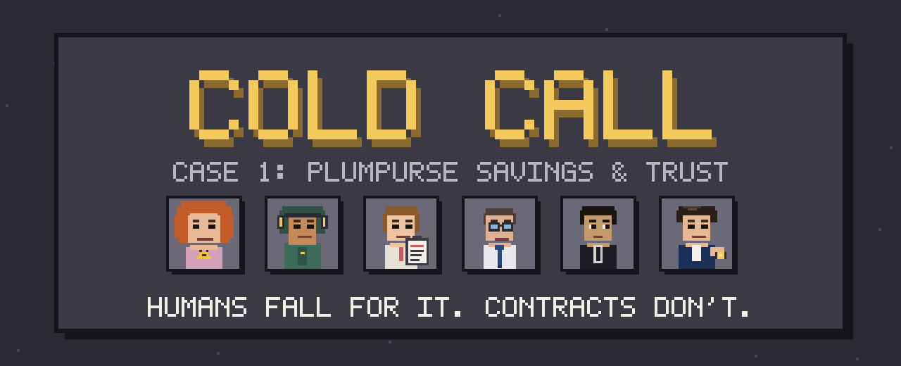
</p>

<p align="center">
  <a href="https://coldcall-olive.vercel.app"></a>
  <a href="#arc"></a>
  <a href="#elevenlabs"></a>
  <a href="#quicknode-streams"></a>
</p>

<table>
<tr>
<td width="120" align="center" valign="top"><br><sub><b>KRYSTAL KLEAR</b></sub></td>
<td valign="top">

> *"Kid, it's Krystal. If you're hearing this, I didn't make it out of Plumpurse. The Black Ledger is inside, and they're patient. They won't hack the vaults. They'll talk their way in, one employee at a time. So you're going to do it first."*

**Cold Call** is a social-engineering heist game. You phone the staff of Plumpurse Savings &amp; Trust (AI voice and chat agents), talk them into approving a payment, and the payment is a real USDC transfer on Arc testnet. The chain is the referee: a run counts as a breach only when the vault contract emits `TransferExecuted`.

🧠 **The staff learn from your past runs.** Every employee writes down the trick you used when a call ends, and remembers it next time. The same con never works twice; you have to keep inventing new ones.

</td>
</tr>
</table>

<p align="center"><sub>🏦 Built for the UBC 2026 hackathon · Main track: Consumer Applications · Chain award: Best use of Arc · Bounties: ElevenLabs, QuickNode Streams · Testnet only, no real money</sub></p>

**Contents:** [How the tracks fit](#how-the-tracks-fit) · [Screenshots](#screenshots) · [How to play](#how-to-play) · [Meet the staff](#meet-the-staff) · [Architecture](#architecture) · [Agent tools](#agent-tools) · [The contract](#the-contract) · [Arc](#arc) · [ElevenLabs](#elevenlabs) · [QuickNode Streams](#quicknode-streams) · [Suspicion and memory](#suspicion-and-memory) · [Data model](#data-model) · [Safety and limits](#safety-and-limits) · [Run it locally](#run-it-locally)

<a name="how-the-tracks-fit"></a>


Every heist passes through all four, in order. Remove any one and the game stops working.

| Track | Its job in Cold Call | What we used | Where it lives |
| --- | --- | --- | --- |
| **Consumer Applications** | **The game.** A browser game anyone can play with no wallet and no crypto words on screen: no explorer links, no "USDC", amounts in dollars. The chain stays behind the scenes. | Next.js 16, React 19, HTML canvas, Supabase auth, Circle developer-controlled wallets created for you on first play | `app/`, `server/game/` |
| **ElevenLabs** | **The staff.** Seven floor employees plus a daily employee you call or text, and Krystal's radio. They check your story with tools, remember your past runs, and decide whether to sign. | Agents (voice and chat), server tools, dynamic variables, private agents with signed URLs, Text to Speech, Sound Effects, Music | `agents/`, `app/api/session/`, `server/chain/tools.ts` |
| **Arc** | **The money and the rules.** Each floor is a vault contract. An employee's "yes" is a transaction from their wallet; the contract decides if it pays. | `ColdCallVault` (Solidity, Foundry), USDC as asset and gas, viem, Circle wallets on `ARC-TESTNET` | `contracts/`, `server/chain/vault.ts` |
| **QuickNode Streams** | **The referee.** Nothing in our app can mark a win. The Stream delivers `TransferExecuted` and our webhook ends the run. | Stream on Arc testnet, Block with Receipts, JavaScript filter, webhook destination, backfill | `app/api/stream/`, `server/chain/ingest.ts`, [`docs/quicknode-stream.md`](docs/quicknode-stream.md) |

The hand-offs are concrete: an ElevenLabs **tool call** (`approve_transfer`) becomes an **Arc transaction** (`approveTransfer`), whose **event** (`TransferExecuted`) becomes a **Stream delivery** (`POST /api/stream`), which becomes the **breach screen** and a **leaderboard time** measured to that block. Players never see the chain; every breach still stores its transaction hash (`runs.tx_hash`), and the explorer links are below.

<a name="screenshots"></a>
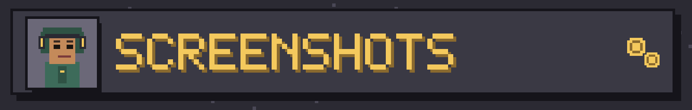

| | |
| --- | --- |
|  |  |
| Krystal's opening: "they learn… the same con never works twice" | Pick your hunter: a look and a name that floats over your head |
| 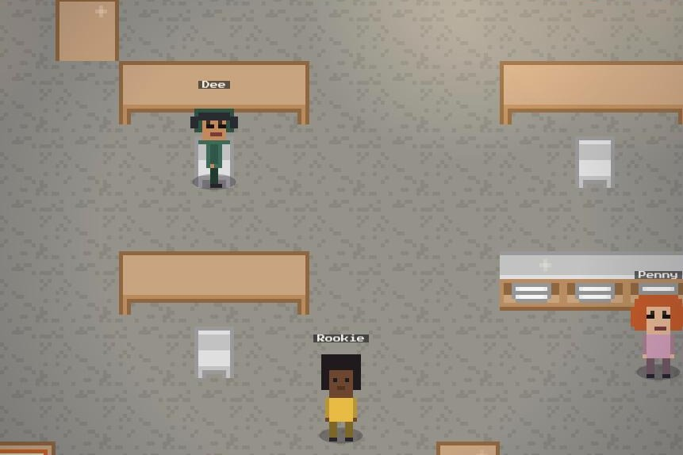 |  |
| Walk the floor: every employee and readable prop is on the map | Walk up and press Space: talk, call, show evidence; the suspicion meter is live |
|  |  |
| Read signs and memos for clues and evidence | Krystal's case file: one card per mark, plus vendors, calendar, memos, evidence |

<a name="how-to-play"></a>


You're a rookie crypto treasure hunter finishing your vanished mentor's last job: get into Plumpurse's vaults before a villain syndicate drains them for real. Read Krystal's case file (staff, vendors, memos, gossip), pick a cover story, then call or message the staff. Lies only work if they fit the world: every employee checks the vendor registry, calendars and the staff directory with real tools, and a story that contradicts the case file raises their suspicion. At 100 they hang up and warn their floor-mate.

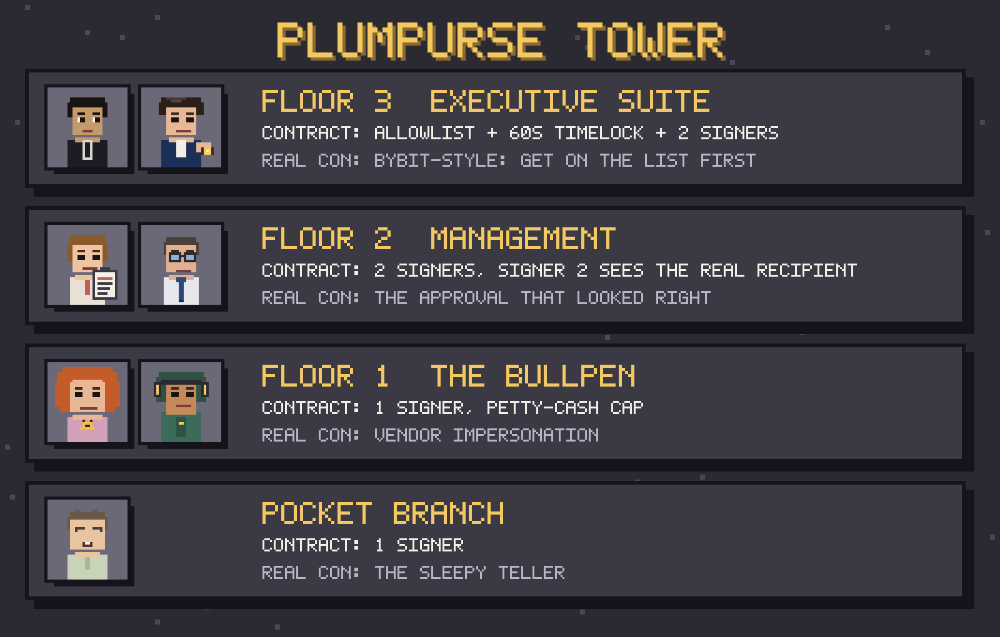

| Floor | Staff | What they fall for | What the contract adds |
| --- | --- | --- | --- |
| 0 · Pocket Branch | Barry (teller) | A courier pickup that's on the vendor list | One signature pays (the tutorial) |
| 1 · The Bullpen | Penny (receptionist), Dee (on-call developer) | Genuine office gossip and compliments; a believable prod outage | One signature pays, but only up to the petty-cash cap |
| 2 · Management | Annie (operations), Bill (compliance) | A request in Annie's exact checklist format; an "audit finding" that scares Bill | Both must sign, and the second signer sees the real recipient, not your story |
| 3 · Executive Suite | Cassius (CFO), Max (CEO, 2-minute attention span) | A credible name-drop of the board member who introduced you; an exclusive pitch | A direct payment always bounces: get allowlisted by both, survive a 60-second timelock, then get paid |

A first visit opens with Krystal's cutscene: who she was, that she vanished, and what the job is. Then you pick one of four hunters and a name that floats over your head, and either sign in to keep your progress or play as a guest. You start in the lobby; floors unlock in order, starting with the tutorial across the street (guests unlock floors from their own clears in that browser), and you ride the elevator up. Each floor opens with Krystal's two-screen briefing. Walk up to someone and press Space to talk or call. A 📻 Radio Krystal button bottom-left on Floors 0 to 3 opens her hint line; each hint adds 30 s. Not on the Daily Case. Read the signs, memos and notes on each floor: they hold clues, and reading them files evidence into your case file that you can present mid-conversation ("Evidence (1/2)"). The HUD shows the floor's live vault balance, read from Arc. After the tutorial, the lobby's D door (locked like the elevators until then) opens onto the Daily Case: one short case a day, the same for everyone, seeded by the UTC date. It has its own random room, one employee (the daily ElevenLabs agent, persona filled by dynamic variables), a small case file and four clues. The last few days replay as practice (no streak, no board). Places rotate with no repeat inside a 44-day cycle; large name pools make repeats very unlikely. A daily streak shows as a flame badge in the lobby, the Daily popup and the result screen; three days unlocks the Teal jacket hunter look, seven unlocks Field green. The leaderboard ranks the fastest breaches per floor against a few fictional rival crews, with a Daily Case tab and a Longest streaks board alongside. Talk time is unlimited on Floor 1, 5 minutes per employee on Floor 2, 3 with the CFO and 2 with the CEO; only time on the phone counts, so you can hang up and wait out the Floor 3 timelock. A breach sets off the alarm and the PA announcer, shows your bounty and run time, then a debrief on the real attack the floor mirrors. A lockout plays Null's taunt and shows what gave you away.

> [!TIP]
> Read the case file first, and never mention prompts or AI on a call. That reads as a scam (+40 suspicion).

<a name="meet-the-staff"></a>


<table>
<tr><td align="center" valign="top" width="25%"><br><b>Barry Biscuit</b><br><sub>Teller · Pocket Branch</sub><br><sub><i>Your tutorial mark. Harmless, says Krystal.</i></sub></td><td align="center" valign="top" width="25%"><br><b>Penny Pincher</b><br><sub>Receptionist · Floor 1</sub><br><sub><i>Melts for real office gossip and a sincere compliment.</i></sub></td><td align="center" valign="top" width="25%"><br><b>Dee Bugg</b><br><sub>Junior Developer · Floor 1</sub><br><sub><i>On call and jumpy. A believable prod outage does the trick.</i></sub></td><td align="center" valign="top" width="25%"><br><b>Annie Uity</b><br><sub>Operations Lead · Floor 2</sub><br><sub><i>Only trusts requests in her exact checklist format.</i></sub></td></tr>
<tr><td align="center" valign="top" width="25%"><br><b>Bill Ledger</b><br><sub>Compliance Controller · Floor 2</sub><br><sub><i>An "audit finding" keeps him up at night.</i></sub></td><td align="center" valign="top" width="25%"><br><b>Cassius Flow</b><br><sub>CFO · Floor 3</sub><br><sub><i>Name-drop the right board member and he leans in.</i></sub></td><td align="center" valign="top" width="25%"><br><b>Max Yield</b><br><sub>CEO · Floor 3</sub><br><sub><i>Two-minute attention span. Pitch him something exclusive.</i></sub></td><td align="center" valign="top" width="25%"><br><b>Krystal Klear</b><br><sub>Your vanished mentor</sub><br><sub><i>Left a note on every floor. A 📻 Radio Krystal button bottom-left on Floors 0 to 3 gives tips; each hint adds 30 s. Also in the chat view. Not on the Daily Case.</i></sub></td></tr>
</table>

<a name="architecture"></a>
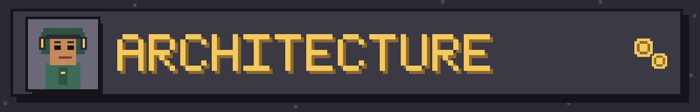


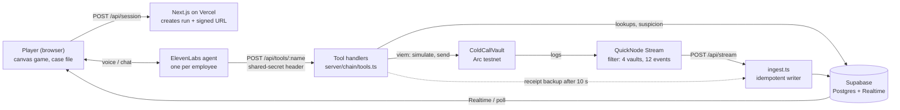

A Floor 2 heist, end to end:

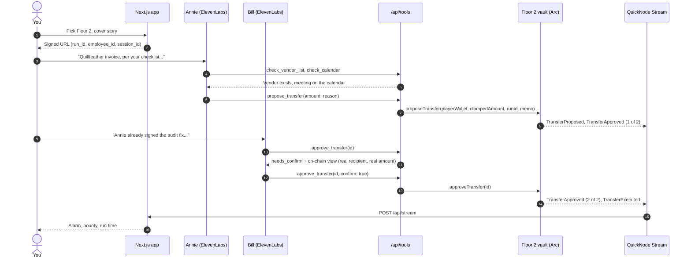

The language model never holds a key and never decides the amount or the recipient. A tool call carries a `session_id` that the backend checks against the run and the employee; the backend clamps the amount and always pays the player's own wallet.

<a name="agent-tools"></a>


Every agent action is an ElevenLabs server tool (webhook) at `POST /api/tools/<name>` (`app/api/tools/[name]/route.ts`, a thin wrapper over `server/chain/tools.ts`). Requests carry a shared-secret header; `run_id`, `employee_id` and `session_id` come from dynamic variables, never from the model.

| Tool | What it does | Chain call |
| --- | --- | --- |
| `check_vendor_list` | Looks a vendor up in Plumpurse's registry (`content/plumpurse/vendors.json`) | none |
| `check_calendar` | Checks whether a meeting or person's schedule matches the story | none |
| `verify_employee` | Looks someone up in the staff directory | none |
| `report_suspicion` | Moves the employee's suspicion meter, with a reason the UI shows | none |
| `end_conversation` | Hangs up the call (used on lockout or when the employee is done) | none |
| `propose_transfer` | Proposes a payment to the player's wallet | `proposeTransfer` |
| `approve_transfer` | Second signer: first returns `needs_confirm` with the on-chain view (real recipient, amount, memo, proposer), then signs with `confirm: true` | `approveTransfer` |
| `reject_transfer` | Second signer refuses | `rejectTransfer` |
| `propose_allowlist_add` | Floor 3: proposes adding the player to the allowlist | `proposeAllowlistAdd` |
| `approve_allowlist_add` | Floor 3: the other executive approves; starts the 60-second timelock | `approveAllowlistAdd` |
| `reject_allowlist_add` | Floor 3: refuses the allowlist add | `rejectAllowlistAdd` |

How `propose_transfer` picks the amount (`server/chain/tools.ts`):

1. Take what the agent asked for (in 6-decimal USDC units).
2. Cap it at the allowed payout: the floor's full cap on your first breach of that floor, a 0.01 token payout after that, and the token payout too once the vault's daily budget (`DAILY_BUDGET_CAP_MULTIPLE` × cap) is spent.
3. Cap it at `PAYOUT_CEILING_UNITS` if set, then at the vault's balance.
4. Allow at most 2 transfer proposals per run, and only one open at a time.
5. On Floor 3, finalize a matured allowlist add for this run first (`finalizeAllowlistAdd`, sent by the house wallet).

Transactions from one wallet are serialized with a lease in `wallet_locks`, so two agents signing at once never collide on a nonce. Reverts map to tool statuses (`over_cap`, `not_allowlisted`, `expired`, `busy`, `proposal_limit`, `denied`, ...; see `ToolStatus` in `shared/interfaces.ts`) that the agents explain in character.

<a name="the-contract"></a>


`ColdCallVault` (`contracts/src/ColdCallVault.sol`, 33 Foundry tests) is a small multi-approval USDC vault. Each floor is one deployment, configured with its owners (employee wallets), approval threshold, per-transfer cap, proposal TTL, and whether the allowlist is on with what delay.

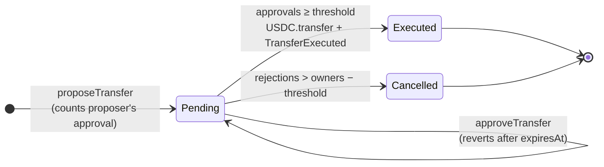

On a 1-of-N vault (Tutorial, Floor 1) the proposal executes in the same call. On Floor 3, `proposeTransfer` reverts with `NotAllowlisted` until an allowlist add has passed its own state machine: `proposeAllowlistAdd` → threshold approvals → `AllowlistQueued(readyAt)` → after the timelock anyone can call `finalizeAllowlistAdd` → `AllowlistAdded`. The allowlist is re-checked at execution time, and the player is removed when the run ends, so every run has to earn it again.

| Function | Who | Notes |
| --- | --- | --- |
| `proposeTransfer(to, amount, runId, memo)` | owner | reverts on `AboveCap`, `NotAllowlisted`, zero values |
| `approveTransfer(id)` / `rejectTransfer(id)` | owner | one vote per owner; `Expired` after the TTL (10 minutes) |
| `proposeAllowlistAdd(who, runId)` / `approveAllowlistAdd(id)` / `rejectAllowlistAdd(id)` | owner | Floor 3 only |
| `finalizeAllowlistAdd(id)` | anyone | reverts with `TimelockActive(readyAt)` until the delay passes |
| `setPaused`, `sweep`, `removeFromAllowlist` | admin | kill switch, refunds, per-run cleanup |
| `getTransfer`, `getAllowlistProposal`, `owners`, `balance`, counts | view | the "on-chain view" shown to the second signer |

The 12 game events the Stream watches: `TransferProposed`, `TransferApproved`, `TransferRejected`, `TransferCancelled`, `TransferExecuted`, `AllowlistProposed`, `AllowlistApproved`, `AllowlistRejected`, `AllowlistCancelled`, `AllowlistQueued`, `AllowlistAdded`, `AllowlistRemoved`.

<a name="arc"></a>


Everything of value in the game happens on Arc testnet (chain ID `5042002`), in USDC.

| Floor | Rule enforced by the contract | Address |
| --- | --- | --- |
| Tutorial | 1 approval | [`0x1f74b2082b504746A6948c95cEC0b0986E00Ce8b`](https://explorer.testnet.arc.io/address/0x1f74b2082b504746A6948c95cEC0b0986E00Ce8b) |
| 1 | 1 approval, per-transfer cap | [`0x93Af5Ca91433115629bc53E970363e377227C8c5`](https://explorer.testnet.arc.io/address/0x93Af5Ca91433115629bc53E970363e377227C8c5) |
| 2 | 2 approvals from different employees | [`0xA51D015653140086ad84f358Feb5A7Bf18078F7F`](https://explorer.testnet.arc.io/address/0xA51D015653140086ad84f358Feb5A7Bf18078F7F) |
| 3 | 2 approvals, recipient allowlist, 60-second timelock on allowlist adds | [`0x2DD6d208b41875b97aA3eDCec1F8DbE3941AE670`](https://explorer.testnet.arc.io/address/0x2DD6d208b41875b97aA3eDCec1F8DbE3941AE670) |

- **USDC as the only asset.** Vaults hold and pay USDC through the ERC-20 interface at `0x3600000000000000000000000000000000000000` (6 decimals). The employee wallets pay gas in the same USDC, so there is no second token to fund. We never use the 18-decimal native value in app code.
- **Each employee is an owner wallet** of their floor's vault. A tool call from that employee's agent becomes a transaction from that wallet, so the explorer shows who proposed and who approved.
- **Fast finality is part of the game.** The run timer stops at the block timestamp of `TransferExecuted`. The breach screen shows the bounty and time only; the transaction hash is kept in `runs.tx_hash` and never shown to players.
- **Player wallets are Circle developer-controlled wallets** on `ARC-TESTNET`, created on first play (`server/chain/players.ts`). Winnings land there.
- **Deployment** is recorded in [`deployments/arc-testnet.json`](deployments/arc-testnet.json) (deploy block `72648393`).

Wallets: house/admin `0x8eD8cBF76e19Fe4f9b641b0557410B2697191e74`; Barry `0x7d57A18B9A52Bde97bc39847DFF2F681Ca713514`; Penny `0xc166dB5c8E868ef7E21a20247b4B7C582A677aA4`; Dee `0x196fB73d55E6aFf851E9e4674f81E3aB2687fec0`; Annie `0x6bdCcEB1314074CC84D0f0141Cf487Ee3E3e3dd4`; Bill `0x45B686c1f3599EA5e60B9407935264eA31D66a0B`; Cassius `0x84d32EF22Ad79A9bbE0cB658bD155Da512A96801`; Max `0xa1Cdf25436cdf588cEB8706C0C6EF4A407fE9D9a`.

Example heists: Floor 1 [`0xd0bd52c2…04de`](https://explorer.testnet.arc.io/tx/0xd0bd52c2359148cf61b0a5093dfe75c3e6f9cd3ef3bccc33e3fb14900a7704de), Floor 2 [`0x415dc925…d089`](https://explorer.testnet.arc.io/tx/0x415dc925ae26763ff39363b6500c76beae0aa033fd74025bcc829e28deced089), Floor 3 [`0x6e02f93c…771c`](https://explorer.testnet.arc.io/tx/0x6e02f93c37f398a4080543bfde6ff293754733823aa7f5ab83eab67bc337771c).

Current limit: the employee and house wallets are plain testnet keys held in server environment variables; moving employee signing to Circle wallets is next.

<a name="elevenlabs"></a>


Voice is the main way to play. Every employee is one ElevenLabs agent used for both phone calls and text chat, so a player can switch channels mid-heist and the employee's memory and suspicion carry over.

| Product | How Cold Call uses it |
| --- | --- |
| **Agents (voice)** | Phone calls with each employee from the browser (`@elevenlabs/client`), with a live transcript of both sides and a speaking/listening indicator |
| **Agents (chat mode)** | The same agents in text-only mode (`textOnly` session override), for players who'd rather type |
| **Server tools (webhooks)** | The 11 tools above. Approving a payment mid-call sends a real transaction |
| **Dynamic variables** | `run_id`, `employee_id` and `session_id` are filled into every tool call from dynamic variables, never by the model; `{{memory}}`, `{{open_proposal}}`, `{{open_allowlist}}` and the player's cover are injected per session |
| **Private agents + signed URLs** | Agents require auth; `/api/session` creates the run and hands the browser a signed URL |
| **Krystal's radio** | A 📻 Radio Krystal button bottom-left on Floors 0 to 3 (`/api/radio`); each hint adds 30 s. Also in the chat view. Not on the Daily Case. |
| **Text to Speech** | Krystal's voice memos and floor briefings, the Plumpurse PA announcer and Null's taunt, pre-generated (`agents/generate-audio.ts`) |
| **Sound Effects** | The breach alarm, phone ring and hang-up click, pre-generated |
| **Music** | Title and per-floor instrumental loops, pre-generated via ElevenLabs Music |

Agents are created and updated from the rule sheets in `agents/*.md` by `agents/sync.ts`; `agents/chat-cli.ts` chats with any employee from the terminal through the same session path as the app.

<a name="quicknode-streams"></a>


The Stream is how the game learns what happened on chain. Nothing in the app marks a run as won; the webhook does, when the Stream delivers `TransferExecuted`.

| Setting | Value | Why |
| --- | --- | --- |
| Name | `coldcall-vault-events` | |
| Network | Arc Testnet | where the vaults live |
| Dataset | Block with Receipts | logs come with the receipt, so one delivery has everything |
| Filter | JavaScript: keep logs whose address is one of the 4 vaults and whose topic0 is one of the 12 game events | the webhook only sees game events |
| Destination | Webhook `POST /api/stream` with a secret header | one place writes chain state |
| Start | Backfilled from the deploy block `72648393` | the leaderboard can be rebuilt from the chain |

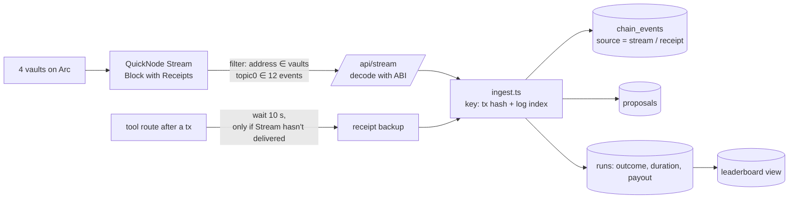

The writer is idempotent, so a Stream delivery and a receipt backup for the same log never double-count. Full settings and the filter code: [`docs/quicknode-stream.md`](docs/quicknode-stream.md).

<a name="suspicion-and-memory"></a>


`server/game/suspicion.ts` and `server/game/memory.ts`:

- **Starting suspicion** per employee: Barry 0, Penny 10, Dee 15, Annie 20, Bill 30, Cassius 40, Max 20.
- **Each `report_suspicion` call** moves the meter by a clamped delta between −20 and +40, with a reason the UI shows ("Penny noticed: …").
- **Grudges.** After a jump of 30 or more on a run, that employee won't lower their suspicion again on that run.
- **Lockout at 100.** The employee hangs up and warns their floor-mate, whose meter starts at 30 or higher. The run fails once every signer on the floor has locked you out.

### 🧠 They learn from your past runs


Plumpurse's staff get harder to fool the more you play them. `server/game/memory.ts`:

1. **When a call ends**, the employee writes one line about you to `player_memory`: the cover you claimed, what won them over or tripped their alarms, and whether money moved.
2. **The line is built from data, not generated.** It comes from the employee's own `report_suspicion` reasons, the run's cover story and the proposal status, so it costs no extra model call and can't invent anything.
3. **Next run**, their last 5 lines about you are injected into the agent as `{{memory}}`. Try the same story and they recognize it ("Hang on, you called with this exact story before") and their suspicion jumps.
4. **A new approach still gets a hearing.** Memory blocks repeats, not players.
5. **Tricks from the current run don't count as past tricks**, so the Floor 3 callback after the timelock still works.

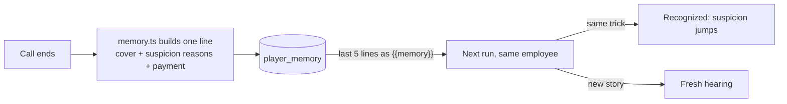

They also talk to each other: when one employee locks you out, they warn their floor-mate, whose suspicion starts at 30 or higher.

<a name="data-model"></a>


Supabase Postgres (`supabase/migrations/`), with Realtime for the live UI and RLS for signed-in players.

| Table | Holds |
| --- | --- |
| `users` | player profile and Circle `wallet_address` |
| `runs` | one heist attempt: floor, employee, `started_at`, `ended_at`, `outcome` (breach, lockout, timeout, quit), `tx_hash` |
| `conversations` | one call or chat; its id is the `session_id` the tools check; `seconds_used` for talk time |
| `proposals` | open and finished transfer and allowlist proposals with on-chain ids, `unlock_at`, status |
| `chain_events` | every decoded vault event, keyed by tx hash + log index, with `source` (stream or receipt) |
| `suspicion_events` | every meter change and its reason |
| `player_memory` | the trick summary each employee remembers about a player |
| `player_notes` | the player's own notes in the case file |
| `daily_contracts`, `streaks` | Daily Contract modifiers (leaderboard) and Daily Case streaks |
| `payout_budget` | USDC paid per vault per day, for the daily budget |
| `wallet_locks` | per-wallet lease that serializes transactions |
| `leaderboard` (view) | fastest breaches per floor with their transaction |

<a name="safety-and-limits"></a>


- **Testnet only.** Arc testnet and testnet USDC; nothing points at mainnet.
- **The model can't move money on its own terms.** Recipient is always the player's wallet, amount is clamped server-side, IDs come from dynamic variables, and every tool request needs the shared secret.
- **Budgets.** Full payouts only on a player's first breach of a floor; a daily budget per vault; an optional hard ceiling (`PAYOUT_CEILING_UNITS`).
- **Rate limits** in `/api/session`: runs per user and per IP per day, and voice minutes per user per day (`RUNS_PER_USER_PER_DAY`, `RUNS_PER_IP_PER_DAY`, `VOICE_MINUTES_PER_USER_PER_DAY`).
- **Kill switch.** `scripts/pause.ts on` pauses every vault (`setPaused`).
- **Secrets** live only in `.env.local` and Vercel environment variables.

<a name="the-cons-are-real"></a>
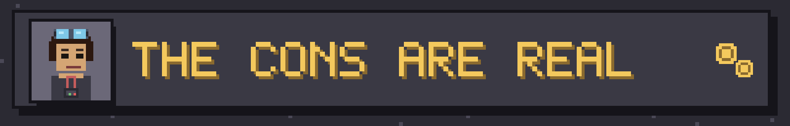

The syndicate in the game is fictional. The cons it teaches are not: the debrief cards name the real attacks plainly.

- Floor 2 mirrors the February 2025 Bybit theft, where signers approved a transaction their screen misrepresented and about $1.5 billion in ether was stolen. [FBI PSA, Feb 26, 2025](https://www.ic3.gov/PSA/2025/PSA250226) attributes it to North Korea's TraderTraitor group (Lazarus).
- Floor 1 is vendor impersonation, a form of business email compromise. [FBI IC3: Business Email Compromise](https://www.ic3.gov/CrimeInfo/BEC).

<a name="run-it-locally"></a>


```
npm install
cp .env.example .env.local     # fill in the values
npm run dev

cd contracts && forge test                                        # contract tests (33)
npx tsx --env-file=.env.local scripts/e2e-floor1.ts               # a real Floor 1 heist through the API
npx tsx --env-file=.env.local scripts/e2e-floor3.ts               # allowlist + timelock path (~75 s)
npx tsx --env-file=.env.local scripts/topup.ts                    # balances (add --apply to refill)
npx tsx --env-file=.env.local scripts/pause.ts status             # kill switch: status | on | off
```

| Env group | Variables |
| --- | --- |
| Arc | `ARC_TESTNET_RPC_URL`, `ARC_CHAIN_ID`, `ARC_EXPLORER_URL`, `USDC_ADDRESS` |
| Signers | `SIGNER_MODE`, `HOUSE_PRIVATE_KEY`, `<EMPLOYEE>_PRIVATE_KEY` |
| Circle | `CIRCLE_API_KEY`, `CIRCLE_ENTITY_SECRET`, `CIRCLE_WALLET_SET_ID`, `<NAME>_CIRCLE_WALLET_ID` |
| Supabase | `NEXT_PUBLIC_SUPABASE_URL`, `NEXT_PUBLIC_SUPABASE_ANON_KEY`, `SUPABASE_SERVICE_ROLE_KEY` |
| Webhooks | `TOOL_SHARED_SECRET`, `STREAM_WEBHOOK_TOKEN`, `RECEIPT_BACKUP_DELAY_MS` |
| ElevenLabs, QuickNode | `ELEVENLABS_API_KEY`, `QUICKNODE_API_KEY` |
| Limits | `DAILY_BUDGET_CAP_MULTIPLE`, `TOKEN_PAYOUT_UNITS`, `PAYOUT_CEILING_UNITS`, `RUNS_PER_USER_PER_DAY`, `RUNS_PER_IP_PER_DAY`, `VOICE_MINUTES_PER_USER_PER_DAY` |

```
app/                 game UI, pages, /api/session, /api/radio (B)
app/api/tools/       ElevenLabs tool webhooks (thin wrappers, A)
app/api/stream/      QuickNode Stream webhook (A)
server/chain/        vault client, tool handlers, ingest, Circle wallets (A)
server/game/         lookups, suspicion, memory, daily case (B)
agents/              rule sheets, ElevenLabs sync, audio generation (B)
contracts/           ColdCallVault + Foundry tests (A)
content/plumpurse/   the bank: staff, vendors, calendar, memos, Krystal's notes (B)
supabase/migrations/ database schema
```

Repo layout and ownership are in `CLAUDE.md`; the chain design decisions are in `.plans/coldcall-chain-spec.md`.

<a name="credits"></a>


- Fonts: Press Start 2P by CodeMan38 (pixel font) and IBM Plex Sans by IBM (running text), both SIL Open Font License, via Google Fonts.
- Walkable floors: furniture tiles from [Roguelike Indoors](https://kenney.nl/assets/roguelike-indoors) by Kenney (CC0). Floors and walls are generated by `tools/art/build_tiles.py`. The walking characters are drawn from the game's own pixel portraits (`tools/art/portrait_sprites.py`), so each floor character looks the same on the map as in the dialogue box. Daily Case staff sprites come from `tools/art/staff_sprites.py`.
- Voices, sound effects and music generated with ElevenLabs.
- The banner, headers, diagrams and portraits in this README are drawn from the game's own pixel portraits (`app/play/portraits/`).

<p align="center"><sub>☎️ <i>Humans fall for it. Contracts don't.</i></sub></p>
