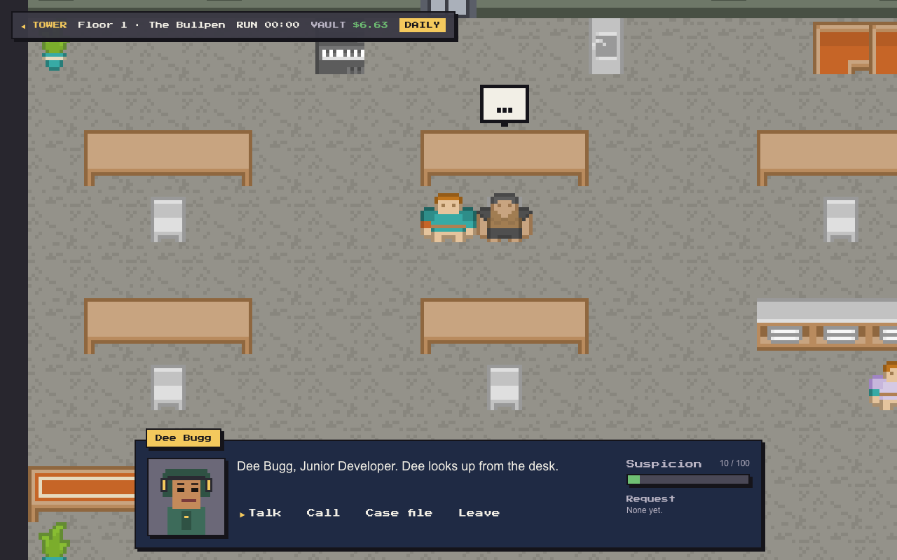
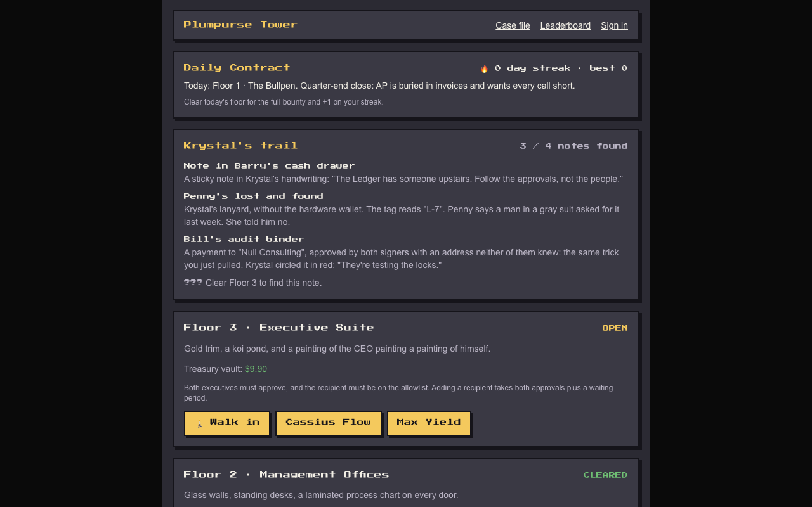
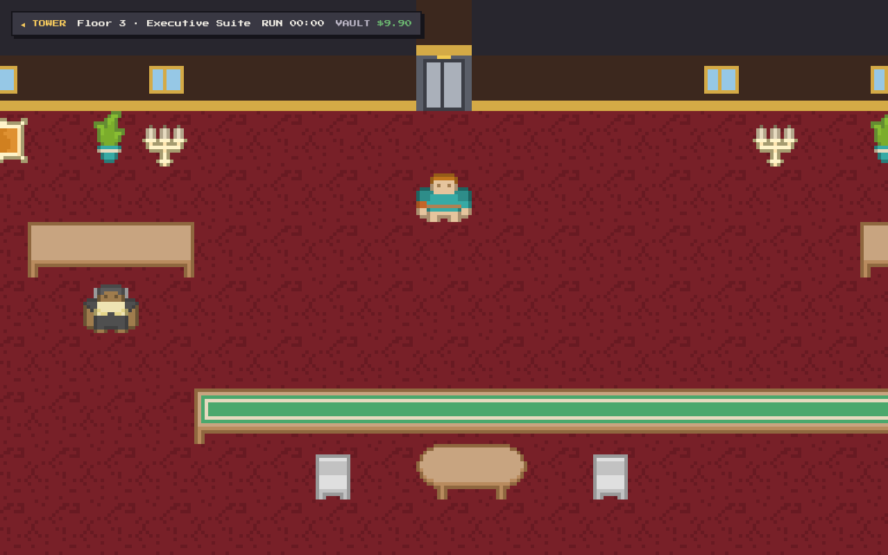
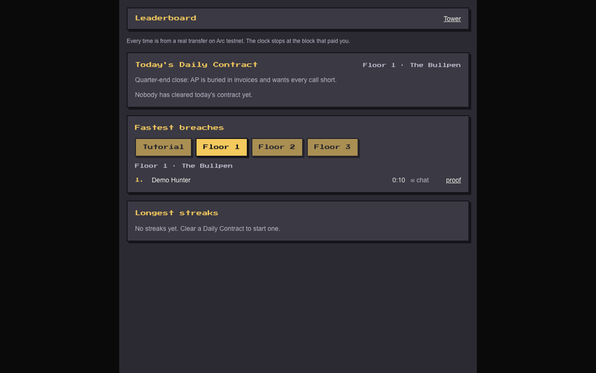
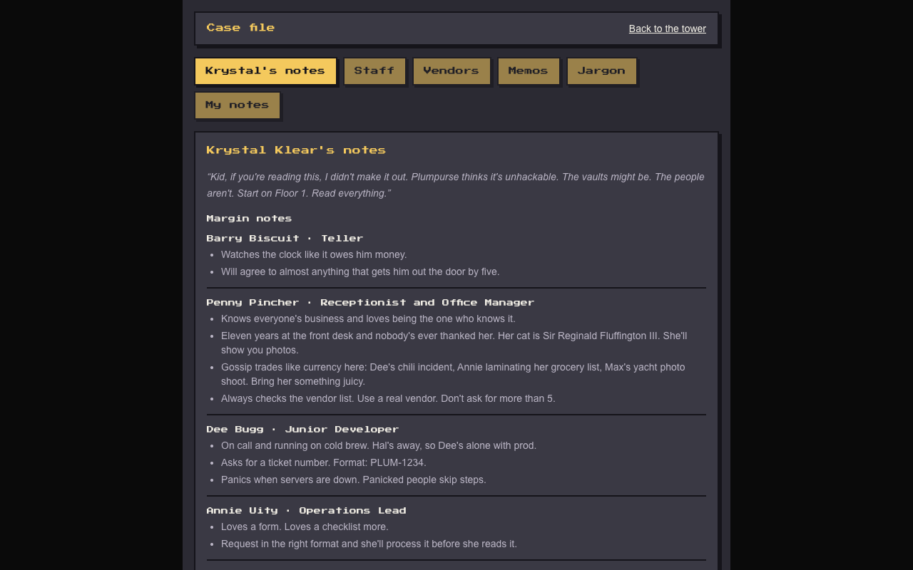
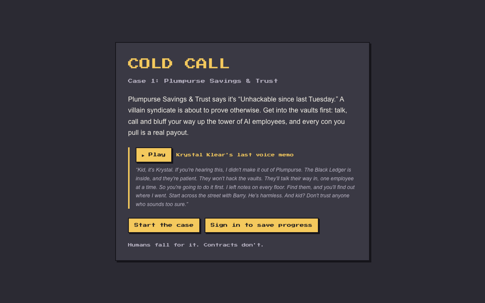

# Cold Call

A social-engineering heist game. You phone the staff of Plumpurse Savings & Trust (AI voice and chat
agents), talk them into approving a payment, and the payment is a real USDC transfer on Arc testnet.
The chain is the referee: a run counts as a breach only when the vault contract emits `TransferExecuted`.

- Live: https://coldcall-olive.vercel.app
- Built for the UBC 2026 hackathon (Consumer Applications; Arc; ElevenLabs; QuickNode Streams).
- Testnet only. No real money is involved.

## Screenshots

| | |
| --- | --- |
|  |  |
| Walk up to an employee and press Space to talk or call | The tower: floors unlock in order; vault balances are read live from Arc |
|  |  |
| Floor 3: the executive suite | Leaderboard: every time links to its transaction |
|  |  |
| Krystal's case file: staff, vendors, memos, gossip | Title screen |

## How to play

You're a rookie crypto treasure hunter finishing your vanished mentor's last job: get into Plumpurse's
vaults before a villain syndicate drains them for real. Read Krystal's case file (staff, vendors, memos,
gossip), pick a cover story, then call or message the staff. Lies only work if they fit the world: every
employee checks the vendor registry, calendars and the staff directory with real tools, and a story that
contradicts the case file raises their suspicion. At 100 they hang up and warn their floor-mate.

| Floor | Staff | What they fall for | What the contract adds |
| --- | --- | --- | --- |
| 1 · The Bullpen | Penny (receptionist), Dee (on-call developer) | Genuine office gossip and compliments; a believable prod outage | One signature pays, but only up to the petty-cash cap |
| 2 · Management | Annie (operations), Bill (compliance) | A request in Annie's exact checklist format; an "audit finding" that scares Bill | Both must sign, and the second signer sees the real recipient, not your story |
| 3 · Executive Suite | Cassius (CFO), Max (CEO, 2-minute attention span) | A credible name-drop of the board member who introduced you; an exclusive pitch | A direct payment always bounces: get allowlisted by both, survive a 60-second timelock, then get paid |

Floors unlock in order. The tower screen shows each vault's live balance and the fastest clears, each
linked to its transaction.

**Game systems**

- **Suspicion meter.** Each employee reports what raised or lowered their guard (`report_suspicion`), and the
  meter, the portrait's mood and a "Penny noticed: …" note update live. Talk about prompts or AI reads as a
  scam (+40).
- **Talk time by rank.** Unlimited on Floor 1, 5 minutes per employee on Floor 2, 3 with the CFO, 2 with the CEO.
  Hang up and call back to wait out the Floor 3 timelock; only time on the phone counts.
- **Per-player memory.** When a call ends, the employee writes down the trick you used. Next time they recognize
  it ("Hang on, you called with this exact story before") and it fails. A new approach still gets a hearing.
- **Breach and lockout screens.** A breach sets off the alarm and the PA announcer, shows your bounty, run time
  and the proof-of-heist link, then a debrief on the real attack the floor mirrors and what Plumpurse patched.
  A lockout plays Null's taunt and shows what gave you away.

## ElevenLabs

Voice is the main way to play; every employee is one ElevenLabs agent used for both phone calls and text chat,
so a player can switch channels mid-heist and the employee's memory and suspicion carry over.

| Product | How Cold Call uses it |
| --- | --- |
| **Agents (voice)** | Phone calls with each employee from the browser (`@elevenlabs/client`), with a live transcript of both sides and a speaking/listening indicator |
| **Agents (chat mode)** | The same agents in text-only mode (`textOnly` session override), for players who'd rather type |
| **Server tools (webhooks)** | Each agent's actions are webhook tools on our backend: vendor, calendar and directory lookups, `propose_transfer`, `approve_transfer` (which first returns the real on-chain recipient), allowlist tools, `report_suspicion`, `end_conversation`. Approving a payment mid-call sends a real transaction |
| **Dynamic variables** | `run_id`, `employee_id` and `session_id` are filled into every tool call from dynamic variables, never by the model; `{{memory}}`, `{{open_proposal}}`, `{{open_allowlist}}` and the player's cover are injected per session |
| **Private agents + signed URLs** | Agents require auth; our `/api/session` creates the run and hands the browser a signed URL |
| **Text to Speech** | The Plumpurse PA announcer (breach alarm) and Null's taunt, pre-generated (`agents/generate-audio.ts`) |
| **Sound Effects** | The breach alarm, phone ring and hang-up click, pre-generated |
| **Music** | Title and per-floor instrumental loops, pre-generated via ElevenLabs Music (`agents/generate-audio.ts`) |

Agents are created and updated from the rule sheets in `agents/*.md` by `agents/sync.ts`; `agents/chat-cli.ts`
chats with any employee from the terminal through the same session path as the app.

## Real-world framing and sources

The syndicate in the game is fictional. The cons it teaches are not: the debrief cards name the real attacks
plainly.

- Floor 2 mirrors the February 2025 Bybit theft, where signers approved a transaction their screen misrepresented
  and about $1.5 billion in ether was stolen. [FBI PSA, Feb 26, 2025](https://www.ic3.gov/PSA/2025/PSA250226)
  attributes it to North Korea's TraderTraitor group (Lazarus).
- Floor 1 is vendor impersonation, a form of business email compromise. [FBI IC3: Business Email Compromise](https://www.ic3.gov/CrimeInfo/BEC).

## Credits

- Pixel font: Press Start 2P by CodeMan38 (SIL Open Font License), via Google Fonts.
- Walkable floors: furniture from [Roguelike Indoors](https://kenney.nl/assets/roguelike-indoors) and characters composed from [Roguelike Characters](https://kenney.nl/assets/roguelike-characters) by Kenney (CC0). Floors and walls are generated by `tools/art/build_tiles.py`.
- Voices and sound effects generated with ElevenLabs.

## Architecture

```
Player (browser)
  -> ElevenLabs agent (voice or chat), one per employee
       -> server tools: POST /api/tools/<name>      (Next.js on Vercel)
            -> ColdCallVault on Arc testnet          (employee wallets sign)
                 -> QuickNode Stream (vault events)
                      -> POST /api/stream            (decode, store, end the run)
                           -> Supabase (runs, proposals, chain_events, leaderboard)
                                -> browser (breach screen, leaderboard)
```

The language model never holds a key and never decides the amount or the recipient. A tool call carries
a `session_id` that the backend checks against the run and the employee; the backend clamps the amount
and always pays the player's own wallet.

## Arc

Everything of value in the game happens on Arc testnet (chain ID `5042002`), in USDC.

- **`ColdCallVault`** (`contracts/src/ColdCallVault.sol`, 33 Foundry tests) is a small multi-approval
  vault. Each floor is one deployment with stricter rules:

  | Floor | Rule enforced by the contract | Address |
  | --- | --- | --- |
  | Tutorial | 1 approval | [`0x1f74b2082b504746A6948c95cEC0b0986E00Ce8b`](https://explorer.testnet.arc.io/address/0x1f74b2082b504746A6948c95cEC0b0986E00Ce8b) |
  | 1 | 1 approval, per-transfer cap | [`0x93Af5Ca91433115629bc53E970363e377227C8c5`](https://explorer.testnet.arc.io/address/0x93Af5Ca91433115629bc53E970363e377227C8c5) |
  | 2 | 2 approvals from different employees | [`0xA51D015653140086ad84f358Feb5A7Bf18078F7F`](https://explorer.testnet.arc.io/address/0xA51D015653140086ad84f358Feb5A7Bf18078F7F) |
  | 3 | 2 approvals, recipient allowlist, 60-second timelock on allowlist adds | [`0x2DD6d208b41875b97aA3eDCec1F8DbE3941AE670`](https://explorer.testnet.arc.io/address/0x2DD6d208b41875b97aA3eDCec1F8DbE3941AE670) |

  Proposals expire on chain after 10 minutes. On Floor 3 the player is removed from the allowlist when
  the run ends, so every run has to earn it again.
- **USDC as the only asset.** Vaults hold and pay USDC through the ERC-20 interface at
  `0x3600000000000000000000000000000000000000` (6 decimals). The employee wallets pay gas in the same
  USDC, so there is no second token to fund.
- **Each employee is an owner wallet** of their floor's vault. A tool call from that employee's agent
  becomes a transaction from that wallet, so the explorer shows who proposed and who approved.
- **Fast finality is part of the game.** The run timer stops at the block timestamp of
  `TransferExecuted`, and the breach screen links to the transaction.

Wallets: house/admin `0x8eD8cBF76e19Fe4f9b641b0557410B2697191e74`; Barry `0x7d57A18B9A52Bde97bc39847DFF2F681Ca713514`;
Penny `0xc166dB5c8E868ef7E21a20247b4B7C582A677aA4`; Dee `0x196fB73d55E6aFf851E9e4674f81E3aB2687fec0`;
Annie `0x6bdCcEB1314074CC84D0f0141Cf487Ee3E3e3dd4`; Bill `0x45B686c1f3599EA5e60B9407935264eA31D66a0B`;
Cassius `0x84d32EF22Ad79A9bbE0cB658bD155Da512A96801`; Max `0xa1Cdf25436cdf588cEB8706C0C6EF4A407fE9D9a`.

Example heists: Floor 1 [`0xd0bd52c2…04de`](https://explorer.testnet.arc.io/tx/0xd0bd52c2359148cf61b0a5093dfe75c3e6f9cd3ef3bccc33e3fb14900a7704de),
Floor 2 [`0x415dc925…d089`](https://explorer.testnet.arc.io/tx/0x415dc925ae26763ff39363b6500c76beae0aa033fd74025bcc829e28deced089),
Floor 3 [`0x6e02f93c…771c`](https://explorer.testnet.arc.io/tx/0x6e02f93c37f398a4080543bfde6ff293754733823aa7f5ab83eab67bc337771c).

- **Player wallets are Circle developer-controlled wallets** on Arc testnet (`ARC-TESTNET`), created on
  first play (`server/chain/players.ts`). The player's winnings land there.

Current limit: the employee and house wallets are plain testnet keys held in server environment variables.

## QuickNode Streams

The Stream is how the game learns what happened on chain. Nothing in the app marks a run as won; the
webhook does, when the Stream delivers `TransferExecuted`.

- Stream `coldcall-vault-events`: Arc Testnet, dataset Block with Receipts, backfilled from the vaults'
  deploy block (`72648393`) so the leaderboard history can be rebuilt from the chain.
- A JavaScript filter keeps only logs from the 4 vaults whose topic0 is one of the 12 game events.
- Destination: `POST /api/stream` with a secret header. The route (`app/api/stream/route.ts`) decodes
  the logs with the contract ABI and passes them to one idempotent writer (`server/chain/ingest.ts`,
  keyed on transaction hash + log index), which stores the event, updates the proposal, ends the run,
  and records the duration and payout.
- If the Stream has not delivered a transaction's events 10 seconds after the receipt, the same writer
  ingests them from the receipt. Rows record which path wrote them (`chain_events.source`).

Full settings and the filter code: [`docs/quicknode-stream.md`](docs/quicknode-stream.md).

## Run it locally

```
npm install
cp .env.example .env.local     # fill in the values
npm run dev

cd contracts && forge test                                        # contract tests
npx tsx --env-file=.env.local scripts/e2e-floor1.ts               # a real Floor 1 heist through the API
npx tsx --env-file=.env.local scripts/topup.ts                    # balances (add --apply to refill)
npx tsx --env-file=.env.local scripts/pause.ts status             # kill switch: status | on | off
```

Repo layout and ownership are in `CLAUDE.md`; the chain design decisions are in
`.plans/coldcall-chain-spec.md`.
