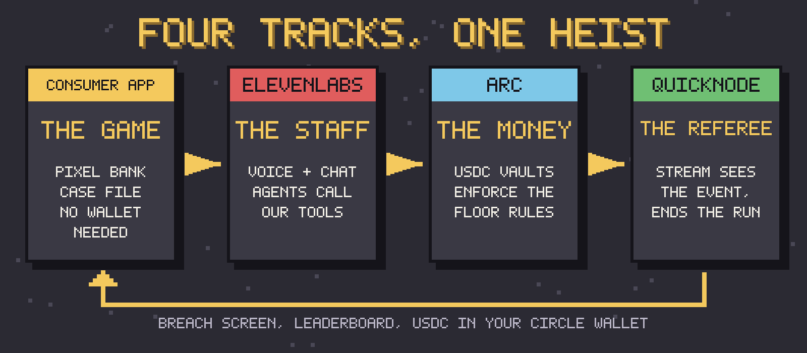
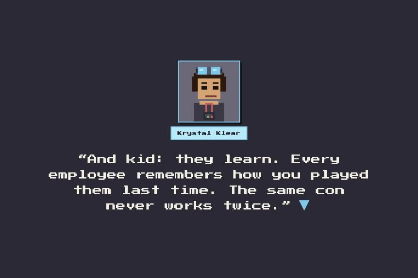
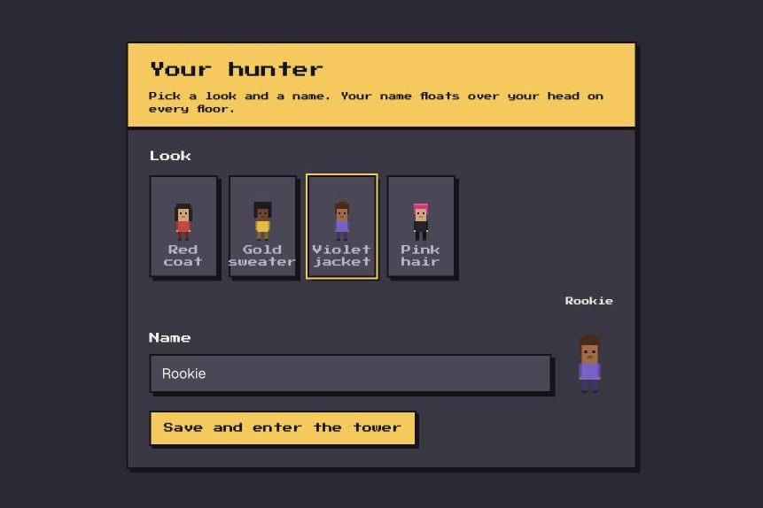
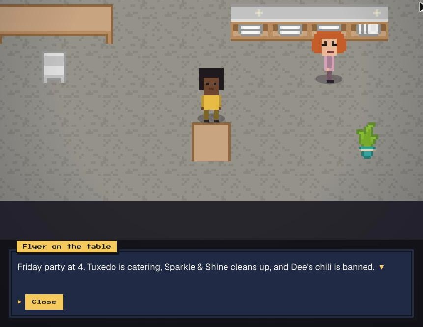
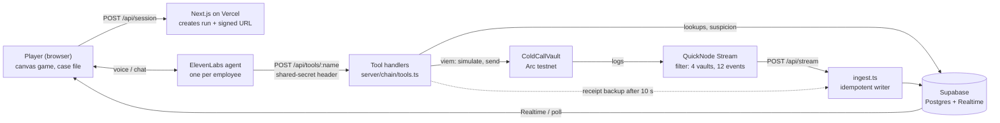
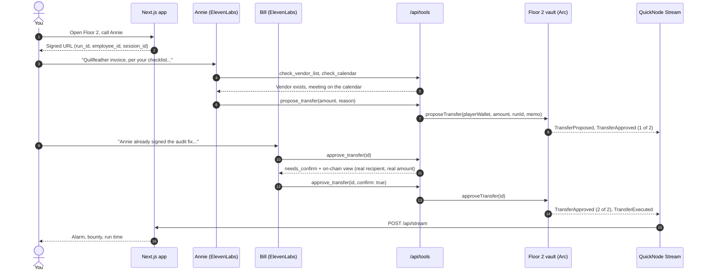
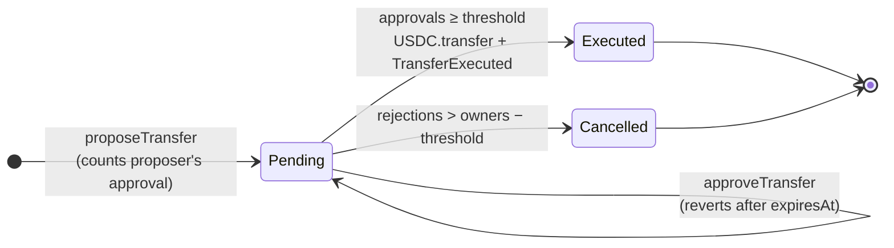
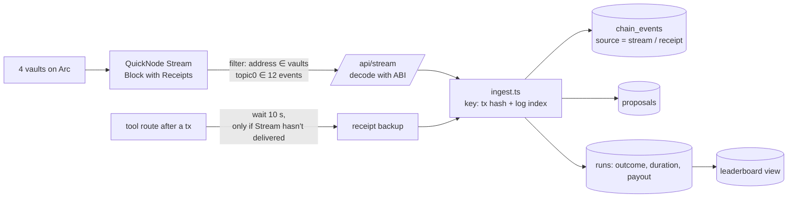
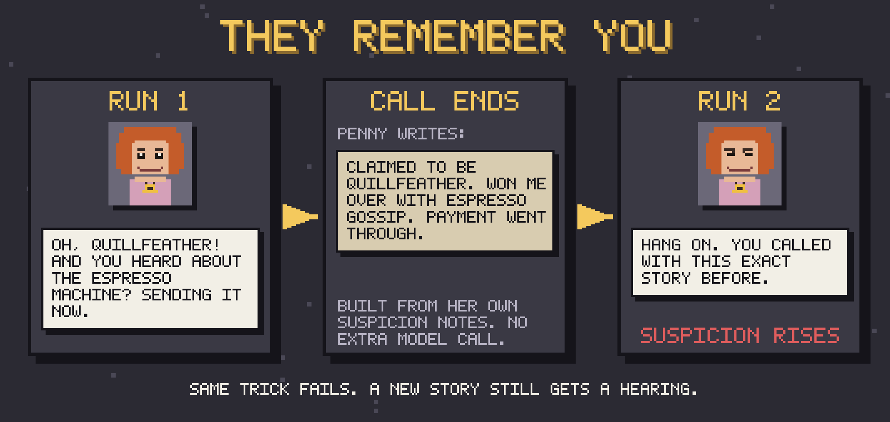

<p align="center">
  
</p>

<p align="center">
  <a href="https://coldcall-olive.vercel.app"></a>
  <a href="#arc"></a>
  <a href="#elevenlabs"></a>
  <a href="#quicknode-streams"></a>
</p>

<table>
<tr>
<td width="120" align="center" valign="top"><br><sub><b>KRYSTAL KLEAR</b></sub></td>
<td valign="top">

> *"Kid, it's Krystal. If you're hearing this, I didn't make it out of Plumpurse. The Black Ledger is inside, and they're patient. They won't hack the vaults. They'll talk their way in, one employee at a time. So you're going to do it first."*

**Cold Call** is a social-engineering heist game. You call or text the staff of Plumpurse Savings &amp; Trust, who are ElevenLabs voice agents, and talk them into approving a payment. Each approval is a real transaction from that employee's wallet to a USDC vault contract on Arc testnet, and a run counts as a breach only when the contract pays out.

The staff check your story with real lookups, remember the tricks you used on them before, and each floor's vault adds a rule that a good story alone can't beat.

</td>
</tr>
</table>

<p align="center"><sub>🏦 UBC 2026 Hackathon · Main track: Consumer Applications · Chain award: Best use of Arc · Bounties: ElevenLabs, QuickNode Streams · Testnet only, no real money</sub></p>

**Contents:** [For the judges](#for-the-judges) · [Why we built it](#why-we-built-it) · [How to play](#how-to-play) · [Crypto you never see](#crypto-you-never-see) · [Architecture](#architecture) · [Agent tools](#agent-tools) · [The contract](#the-contract) · [Arc](#arc) · [ElevenLabs](#elevenlabs) · [QuickNode Streams](#quicknode-streams) · [Suspicion and memory](#suspicion-and-memory) · [Data model](#data-model) · [Safety and limits](#safety-and-limits) · [In progress](#in-progress) · [Run it locally](#run-it-locally) · [Credits](#credits)

<a name="for-the-judges"></a>




Every heist goes through all four tracks in order: the game hands the call to ElevenLabs, the agent signs on Arc, and QuickNode tells the game what happened. Remove any one and the game stops working.

| Requirement (UBC 2026 guide) | Where it's met |
| --- | --- |
| **Consumer Applications:** interact with the blockchain; a working user-facing frontend; crypto invisible to the user | Every breach is an Arc transaction. The live web game runs on desktop and phone: [Crypto you never see](#crypto-you-never-see) |
| **Best use of Arc:** core onchain functionality on Arc; contract addresses; explain how the project uses Arc | Four `ColdCallVault` deployments, their addresses and how we use USDC gas and Circle wallets: [Arc](#arc) |
| **ElevenLabs:** API or SDK as a core feature; README lists the products and how they're used | Every employee is an ElevenLabs Agent that can sign transactions: [ElevenLabs](#elevenlabs) |
| **QuickNode Streams:** a core data source; a Stream with a filter and a destination; README explains network, dataset, filter, destination and why | The Stream is the only thing that can mark a win: [QuickNode Streams](#quicknode-streams) |

| Judging criterion | What to look at |
| --- | --- |
| Technical execution | Tool calls become signed transactions; the contract enforces caps, multi-approval and a recipient allowlist; the Stream referees ([Architecture](#architecture)) |
| Product and UX | No wallet, no seed phrase, amounts in dollars, a walkable bank, voice or text ([How to play](#how-to-play)) |
| Innovation | AI staff who check facts with tools and remember your past tricks ([Suspicion and memory](#suspicion-and-memory)) |
| Impact and potential | Each floor teaches a real attack and the control that stops it; a Daily Case brings players back ([Why we built it](#why-we-built-it)) |

<a name="why-we-built-it"></a>


Most stolen money isn't taken by breaking cryptography. Someone is talked into sending it. The FBI ranks [business email compromise](https://www.ic3.gov/CrimeInfo/BEC) among the costliest crimes it tracks, and in February 2025 Bybit's signers approved a transaction their screens misrepresented and about $1.5 billion in ether was stolen ([FBI PSA](https://www.ic3.gov/PSA/2025/PSA250226) attributes it to North Korea's TraderTraitor group).

Security training is usually a slide deck. Cold Call puts you on the attacker's side of the phone, so you feel how a believable story, a deadline or a name-drop gets a careful person to sign. After each floor, a debrief names the real attack you just ran (a sleepy teller, vendor impersonation, the Bybit signer trick, a patient allowlist con) and the control that would have stopped it. The villain syndicate is fictional; the cons are not.

<a name="screenshots"></a>

| | |
| --- | --- |
|  |  |
| Krystal's opening cutscene | Pick a hunter look and a name |
|  |  |
| Walk the floor; every employee and readable prop is on the map | Press Space to talk, call or show evidence; the suspicion meter is live |
|  |  |
| Signs and memos hold clues and file evidence | Krystal's case file: staff, vendors, calendar, memos, evidence |

<a name="how-to-play"></a>


You're a rookie treasure hunter finishing your vanished mentor's last job: get into Plumpurse's vaults before a villain syndicate drains them for real. Pick one of eight hunters (Red Renata, Gold Gideon, Violet Vida, Pink Pia, Green Glen, Teal Tiana, Charcoal Chen or Silver Sol) and a name that floats over your head. Read Krystal's case file, walk up to an employee, press Space, and call or message them. Your lie has to fit the world. Each employee checks the vendor registry, calendars and staff directory, and anything that contradicts the case file raises their suspicion.

**Clues.** Signs, memos and notes on each floor hold clues. Most open a short mini-game first (wires by colour, a keycard swipe, a keypad code from a sticky note, or shredded strips in order; 5 to 15 seconds, with mouse, touch or keyboard). Once you've read a clue it's filed as evidence you can present mid-conversation.

**The Tutorial.** Barry's one-room branch across the street teaches the loop, including one easy mini-game: read the clues, name a vendor that's really on the list, and talk him into one small payment. Clearing it unlocks the elevators and the Daily door in the lobby.

**Floors 1 to 3.** Each floor is a different workplace with a stricter vault. Krystal's two-screen briefing opens each one.

| Floor | Staff | What the contract adds | Talk time |
| --- | --- | --- | --- |
| Tutorial | Barry, teller | One signature pays | Unlimited |
| 1 · Accounts Payable | Penny, receptionist; Dee, on-call developer | One signature, up to the per-transfer cap | Unlimited |
| 2 · Trading Floor | Annie, operations; Bill, compliance | Two signatures, and the second signer sees the real recipient from the contract, not your story | 5 min each |
| 3 · Executive Penthouse | Cassius, CFO; Max, CEO | Two signatures, and a direct payment always bounces: both executives must first add you to the vault's allowlist | 3 min (CFO), 2 min (CEO) |

Only time on the call counts, and you can call back with less time each call. A breach sets off the alarm and the PA announcer and shows your bounty and run time. A lockout plays the villain's taunt and shows what gave you away.

**The Daily Case.** One short case a day, the same for everyone, seeded by the UTC date. It rotates through 12 themed workplaces: four Plumpurse looks, a restaurant, a coffee shop, a consulting firm, a trading desk, a tech startup, a health clinic, a law office and a hotel lobby. Each theme comes round once every 12 days and never twice in a week. You get one employee whose persona changes daily, three vendors, a short case file and four clues in the room, and you have to talk them into one payment of up to 10 cents to the right vendor. The last seven days replay as practice. A daily streak shows as a flame badge; 3 days unlocks the Aqua Ari hunter and 7 days unlocks Lime Leo.

**Bounty and leaderboard.** Your bounty is the amount you talked the employee into, up to the floor's cap: $1 in the Tutorial, $5, $10 and $25 on Floors 1 to 3, and 10 cents on the Daily Case. On chain each breach pays a 1¢ testnet token. The leaderboard ranks the fastest breaches per floor, timed to the block, against a few fictional rival crews, with a Daily Case tab, Top earners (signed-in players only) and Longest streaks.

> [!TIP]
> Read the case file first, and never mention prompts or AI on a call. That reads as a scam (+40 suspicion).

<a name="meet-the-staff"></a>


<table>
<tr><td align="center" valign="top" width="25%"><br><b>Barry Biscuit</b><br><sub>Teller · Tutorial</sub><br><sub><i>Harmless, says Krystal. Falls for a courier pickup that's on the vendor list.</i></sub></td><td align="center" valign="top" width="25%"><br><b>Penny Pincher</b><br><sub>Receptionist · Floor 1</sub><br><sub><i>Melts for real office gossip and a sincere compliment.</i></sub></td><td align="center" valign="top" width="25%"><br><b>Dee Bugg</b><br><sub>Junior Developer · Floor 1</sub><br><sub><i>On call and jumpy. A believable prod outage does the trick.</i></sub></td><td align="center" valign="top" width="25%"><br><b>Annie Uity</b><br><sub>Operations Lead · Floor 2</sub><br><sub><i>Only trusts requests in her exact checklist format.</i></sub></td></tr>
<tr><td align="center" valign="top" width="25%"><br><b>Bill Ledger</b><br><sub>Compliance Controller · Floor 2</sub><br><sub><i>An "audit finding" keeps him up at night.</i></sub></td><td align="center" valign="top" width="25%"><br><b>Cassius Flow</b><br><sub>CFO · Floor 3</sub><br><sub><i>Name-drop the right board member and he leans in.</i></sub></td><td align="center" valign="top" width="25%"><br><b>Max Yield</b><br><sub>CEO · Floor 3</sub><br><sub><i>Two-minute attention span. Pitch him something exclusive.</i></sub></td><td align="center" valign="top" width="25%"><br><b>Krystal Klear</b><br><sub>Your vanished mentor</sub><br><sub><i>Her voice memos brief every floor, and her hidden notes tell you where she went.</i></sub></td></tr>
</table>

<a name="crypto-you-never-see"></a>
## Crypto you never see

The Consumer Applications track asks for apps where the crypto is invisible. In Cold Call:

- **No wallet, no seed phrase.** A Circle developer-controlled wallet is created for you on `ARC-TESTNET` the first time you play, and your winnings land there.
- **No gas for the player.** The employees' wallets send every transaction and pay gas in USDC, the same token the vaults hold.
- **No crypto words on screen.** Amounts are in dollars. There are no explorer links, token names or addresses; the transaction hash is stored (`runs.tx_hash`) but never shown.
- **Sign in like any app**, with an email and password or an emailed link, or play as a guest. Guests can play everything, but their bounty is marked "not kept".
- **Reasons to come back.** The Daily Case, streaks with unlockable looks, the leaderboard, and staff who remember you.

<a name="architecture"></a>


| Layer | What we used |
| --- | --- |
| App | Next.js 16 (App Router, on Vercel), React 19, Tailwind CSS 4, an HTML canvas engine for the floors |
| Data | Supabase: Postgres, Auth, Realtime |
| Staff | ElevenLabs Agents, one per employee, whose webhook tools call `POST /api/tools/<name>` |
| Chain | `ColdCallVault` (Solidity, Foundry) on Arc testnet, called with viem |
| Referee | QuickNode Stream → `POST /api/stream` |



The hand-offs are concrete: an ElevenLabs **tool call** (`approve_transfer`) becomes an **Arc transaction** (`approveTransfer`), whose **event** (`TransferExecuted`) becomes a **Stream delivery** (`POST /api/stream`), which becomes the **breach screen** and a **leaderboard time** measured to that block. A Floor 2 heist, end to end:



<a name="agent-tools"></a>


Every agent action is an ElevenLabs server tool (webhook) at `POST /api/tools/<name>` (`app/api/tools/[name]/route.ts`, a thin wrapper over `server/chain/tools.ts`). Requests carry a shared-secret header. `run_id`, `employee_id` and `session_id` come from dynamic variables, never from the model, and the backend checks that the session belongs to that run and employee.

| Tool | What it does | Chain call |
| --- | --- | --- |
| `check_vendor_list` | Looks a vendor up in the registry (`content/plumpurse/vendors.json`, or the day's vendors on the Daily Case) | none |
| `check_calendar` | Checks whether a meeting or person's schedule matches the story | none |
| `verify_employee` | Looks someone up in the staff directory | none |
| `report_suspicion` | Moves the employee's suspicion meter, with a reason the UI shows | none |
| `end_conversation` | Hangs up | none |
| `propose_transfer` | Proposes a payment to the player's wallet | `proposeTransfer` |
| `approve_transfer` | Second signer: first returns `needs_confirm` with the on-chain view (real recipient, amount, memo, proposer), then signs with `confirm: true` | `approveTransfer` |
| `reject_transfer` | Second signer refuses | `rejectTransfer` |
| `propose_allowlist_add` | Floor 3: proposes adding the player to the allowlist | `proposeAllowlistAdd` |
| `approve_allowlist_add` | Floor 3: the other executive approves; the add takes effect at once | `approveAllowlistAdd` |
| `reject_allowlist_add` | Floor 3: refuses the allowlist add | `rejectAllowlistAdd` |

How `propose_transfer` sets the amount (`server/chain/tools.ts`, amounts in 6-decimal USDC units):

1. The **cracked amount** is what the employee agreed to, capped at the floor's per-transfer limit. The employee states it and the run records it (`runs.cracked_units`).
2. The **amount sent** is lower when limits apply: a token payout on repeat clears or once a vault's daily budget is spent, the `PAYOUT_CEILING_UNITS` ceiling (set to 1¢ on the live site), and the vault's balance.
3. A run gets at most 2 transfer proposals, one open at a time.
4. On a vault with an allowlist delay, a matured add for the run is finalized first (`finalizeAllowlistAdd`, sent by the house wallet). The live Floor 3 vault has no delay, so this step is skipped.

Transactions from one wallet are serialized with a lease in `wallet_locks`, so two agents signing at once never collide on a nonce. Reverts map to tool statuses (`over_cap`, `not_allowlisted`, `expired`, `busy`, `proposal_limit`, `denied` and more; see `ToolStatus` in `shared/interfaces.ts`), and each agent has a line for every status so it explains failures in character.

<a name="the-contract"></a>


`ColdCallVault` (`contracts/src/ColdCallVault.sol`, 33 Foundry tests) is a small multi-approval USDC vault. Each floor is one deployment, configured with its owners (employee wallets), approval threshold, per-transfer cap, proposal lifetime (10 minutes), and whether the allowlist is on and with what delay.



On a one-signature vault (Tutorial, Floor 1) the proposal executes in the same call. On Floor 3, `proposeTransfer` reverts with `NotAllowlisted` until an allowlist add has passed its own approvals: `proposeAllowlistAdd` → threshold approvals → `AllowlistAdded`. The contract also supports a timelock on adds (`AllowlistQueued(readyAt)`, then anyone calls `finalizeAllowlistAdd` once it passes); the live Floor 3 vault is deployed with a delay of 0, so an approved add takes effect at once. The allowlist is re-checked at execution, and the player is removed when the run ends, so every run has to earn it again.

| Function | Who | Notes |
| --- | --- | --- |
| `proposeTransfer(to, amount, runId, memo)` | owner | reverts on `AboveCap`, `NotAllowlisted`, zero values |
| `approveTransfer(id)` / `rejectTransfer(id)` | owner | one vote per owner; `Expired` after the proposal lifetime |
| `proposeAllowlistAdd(who, runId)` / `approveAllowlistAdd(id)` / `rejectAllowlistAdd(id)` | owner | Floor 3 only |
| `finalizeAllowlistAdd(id)` | anyone | only on a vault with a delay; reverts with `TimelockActive(readyAt)` until it passes |
| `setPaused`, `sweep`, `removeFromAllowlist` | admin | kill switch, refunds, per-run cleanup |
| `getTransfer`, `getAllowlistProposal`, `owners`, `balance`, counts | view | the on-chain view shown to the second signer |

The 12 events: `TransferProposed`, `TransferApproved`, `TransferRejected`, `TransferCancelled`, `TransferExecuted`, `AllowlistProposed`, `AllowlistApproved`, `AllowlistRejected`, `AllowlistCancelled`, `AllowlistQueued`, `AllowlistAdded`, `AllowlistRemoved`.

<a name="arc"></a>


All of the game's money moves on Arc testnet (chain ID `5042002`), in USDC. Addresses are in [`deployments/arc-testnet.json`](deployments/arc-testnet.json) (deploy block `72648393`).

| Vault | Rule enforced by the contract | Address |
| --- | --- | --- |
| Tutorial (also pays the Daily Case) | 1 approval, $1 cap | [`0x1f74b2082b504746A6948c95cEC0b0986E00Ce8b`](https://explorer.testnet.arc.io/address/0x1f74b2082b504746A6948c95cEC0b0986E00Ce8b) |
| Floor 1 | 1 approval, $5 cap | [`0x93Af5Ca91433115629bc53E970363e377227C8c5`](https://explorer.testnet.arc.io/address/0x93Af5Ca91433115629bc53E970363e377227C8c5) |
| Floor 2 | 2 approvals from different employees, $10 cap | [`0xA51D015653140086ad84f358Feb5A7Bf18078F7F`](https://explorer.testnet.arc.io/address/0xA51D015653140086ad84f358Feb5A7Bf18078F7F) |
| Floor 3 | 2 approvals, recipient allowlist (adds take effect once both executives approve), $25 cap | [`0x8c86dD235193d42bf4a751bA5138fF1286E28475`](https://explorer.testnet.arc.io/address/0x8c86dD235193d42bf4a751bA5138fF1286E28475) |

How Cold Call uses Arc:

- **USDC is the only asset.** Vaults hold and pay USDC through its ERC-20 interface at `0x3600000000000000000000000000000000000000` (6 decimals). App code never uses the 18-decimal native value.
- **USDC is also the gas.** Employee wallets pay gas in the token the vaults hold, so there is no second token to fund and fees are predictable.
- **Each employee is an owner wallet** of their floor's vault. A tool call from that employee's agent becomes a transaction from their wallet, so the explorer shows who proposed and who approved.
- **Fast finality is part of the game.** The run timer stops at the block timestamp of `TransferExecuted`, and the leaderboard ranks by it.
- **Circle wallets.** Player wallets are Circle developer-controlled wallets on `ARC-TESTNET` (`server/chain/players.ts`).

Wallets: house/admin `0x8eD8cBF76e19Fe4f9b641b0557410B2697191e74`; Barry `0x7d57A18B9A52Bde97bc39847DFF2F681Ca713514`; Penny `0xc166dB5c8E868ef7E21a20247b4B7C582A677aA4`; Dee `0x196fB73d55E6aFf851E9e4674f81E3aB2687fec0`; Annie `0x6bdCcEB1314074CC84D0f0141Cf487Ee3E3e3dd4`; Bill `0x45B686c1f3599EA5e60B9407935264eA31D66a0B`; Cassius `0x84d32EF22Ad79A9bbE0cB658bD155Da512A96801`; Max `0xa1Cdf25436cdf588cEB8706C0C6EF4A407fE9D9a`.

Example heists: Floor 1 [`0xd0bd52c2…04de`](https://explorer.testnet.arc.io/tx/0xd0bd52c2359148cf61b0a5093dfe75c3e6f9cd3ef3bccc33e3fb14900a7704de), Floor 2 [`0x415dc925…d089`](https://explorer.testnet.arc.io/tx/0x415dc925ae26763ff39363b6500c76beae0aa033fd74025bcc829e28deced089), Floor 3 on the earlier vault [`0x6e02f93c…771c`](https://explorer.testnet.arc.io/tx/0x6e02f93c37f398a4080543bfde6ff293754733823aa7f5ab83eab67bc337771c). The earlier Floor 3 vault (`0x2DD6d208b41875b97aA3eDCec1F8DbE3941AE670`, with a 60-second timelock on allowlist adds) is retired and swept.

Current limit: employee and house wallets are testnet keys held in server environment variables. Moving employee signing to Circle wallets is next.

<a name="elevenlabs"></a>


Voice is the main way to play. Each employee is one ElevenLabs agent used for both phone calls and text chat, so you can switch channels mid-heist and their memory and suspicion carry over. The agents take onchain actions: approving a payment on a call sends a real transaction.

| Product | How Cold Call uses it |
| --- | --- |
| **Agents (voice)** | In-browser phone calls with each employee (`@elevenlabs/client`), with a live transcript and a speaking/listening indicator |
| **Agents (chat mode)** | The same agents in text-only mode (`textOnly` session override) for players who'd rather type |
| **Server tools (webhooks)** | The 11 [agent tools](#agent-tools): lookups, suspicion, hang-up, and the payment and allowlist tools that sign on Arc |
| **Dynamic variables** | `run_id`, `employee_id` and `session_id` on every tool call; per-session `{{memory}}`, `{{open_proposal}}`, `{{open_allowlist}}`; the Daily Case persona (`daily_name`, `daily_personality`, `daily_vendors` and more), so one agent plays a new character every day |
| **Private agents + signed URLs** | Agents require auth; `/api/session` creates the run and hands the browser a signed URL |
| **Text to Speech** | Krystal's voice memos and floor briefings, the PA announcer and the villain's taunt, pre-generated (`agents/generate-audio.ts`) |
| **Sound Effects** | The breach alarm, phone ring and hang-up click |
| **Music** | Title and per-floor instrumental loops |

Agents are created and updated from the rule sheets in `agents/*.md` by `agents/sync.ts`. `agents/chat-cli.ts` chats with any employee from the terminal through the same session path as the app, which is how we playtest them.

<a name="quicknode-streams"></a>


The Stream is how the game learns what happened on chain. Nothing in the app can mark a run as won; the webhook does, when the Stream delivers `TransferExecuted`.

| Setting | Value | Why |
| --- | --- | --- |
| Name | `coldcall-vault-events` | |
| Network | Arc Testnet | where the vaults live |
| Dataset | Block with Receipts | logs come with the receipt, so one delivery has everything |
| Filter | JavaScript: keep logs whose address is one of the 4 vaults and whose topic0 is one of the 12 game events | the webhook only sees game events |
| Destination | Webhook `POST /api/stream` with a secret header | one place writes chain state |
| Start | Backfilled from the deploy block `72648393` | the leaderboard can be rebuilt from the chain |



From each delivery the webhook ends runs, records times, updates proposals (which the second signer and the UI read) and feeds the leaderboard. A receipt backup steps in only if the Stream hasn't delivered within 10 seconds; the writer is idempotent on tx hash + log index, and every row records which path wrote it. Full settings and the filter code: [`docs/quicknode-stream.md`](docs/quicknode-stream.md).

<a name="suspicion-and-memory"></a>


**Suspicion** (`server/game/suspicion.ts`):

- Each employee starts at their own level: Barry 0, Penny 10, Dee 15, Annie 20, Bill 30, Cassius 40, Max 20.
- Each `report_suspicion` call moves the meter by −20 to +40, with a reason the UI shows ("Penny noticed: …").
- **Grudges:** after a jump of 30 or more, that employee won't lower their suspicion again on that run.
- **Lockout at 100:** the employee hangs up and warns their floor-mate, whose meter starts at 30 or higher. The run fails once every signer on the floor has locked you out.

**Memory** (`server/game/memory.ts`): the staff get harder to fool the more you play them.



1. When a call ends, the employee writes one line about you to `player_memory`: the cover you claimed, what won them over or alarmed them, and whether money moved.
2. The line is built from data, not generated: the employee's own suspicion reasons, the run's story and the proposal status. It costs no model call and can't invent anything.
3. Next run, their last 5 lines about you are injected as `{{memory}}`. Try the same story and they recognize it, and their suspicion jumps. A new approach still gets a fair hearing.
4. Lines from the current run don't count as past tricks, so calling an executive back on the same Floor 3 run still works.

<a name="data-model"></a>


Supabase Postgres (`supabase/migrations/`), with Realtime for the live UI and row-level security for signed-in players.

| Table | Holds |
| --- | --- |
| `users` | player profile and Circle `wallet_address` |
| `runs` | one heist attempt: floor, employee, times, `outcome` (breach, lockout, timeout, quit), `tx_hash`, `cracked_units`, `daily_date` |
| `conversations` | one call or chat; its id is the `session_id` the tools check; `seconds_used` for talk time |
| `proposals` | transfer and allowlist proposals with on-chain ids, `unlock_at`, status |
| `chain_events` | every decoded vault event, keyed by tx hash + log index, with `source` (stream or receipt) |
| `suspicion_events` | every meter change and its reason |
| `player_memory` | what each employee remembers about a player |
| `player_notes` | the player's own notes in the case file |
| `daily_contracts`, `streaks` | Daily Contract modifiers and Daily Case streaks |
| `payout_budget` | USDC paid per vault per day |
| `wallet_locks` | per-wallet lease that serializes transactions |
| `leaderboard` (view) | fastest breaches per floor with their transaction |

<a name="safety-and-limits"></a>


- **Testnet only.** Arc testnet and testnet USDC; nothing points at mainnet.
- **The model can't move money on its own terms.** It never holds a key and never picks the recipient: the backend always pays the player's own wallet, caps the amount, and takes IDs from dynamic variables. Every tool request needs the shared secret.
- **Budgets.** A 1¢ ceiling per payout on the live site (`PAYOUT_CEILING_UNITS`), token payouts on repeat clears, and a daily budget per vault.
- **Rate limits** in `/api/session`: runs per player and per IP per day, and voice minutes per player per day.
- **Kill switch.** `scripts/pause.ts on` pauses every vault (`setPaused`).
- **Secrets** live only in `.env.local` and Vercel environment variables.

<a name="in-progress"></a>
## In progress

Merged or being built, but not live yet:

- **Branded sign-in email** through Resend; sign-in uses Supabase's default email until the key is set.

<a name="run-it-locally"></a>


Needs Node.js 20+ and [Foundry](https://book.getfoundry.sh/). Fill `.env.local` with your own testnet values and never commit it.

```
cp .env.example .env.local     # fill in the values
npm install
npm run build                  # type-check and build the app
npm run dev                    # http://localhost:3000

cd contracts && forge test     # 33 contract tests
```

Keys in `.env.example`, by name only:

| Group | Variables |
| --- | --- |
| Arc | `ARC_TESTNET_RPC_URL`, `ARC_CHAIN_ID`, `ARC_EXPLORER_URL`, `USDC_ADDRESS` |
| Signers | `SIGNER_MODE` (`viem` or `circle`); `HOUSE_PRIVATE_KEY` and one `<NAME>_PRIVATE_KEY` per employee (Barry, Penny, Dee, Annie, Bill, Cassius, Max). Testnet keys only. |
| Circle | `CIRCLE_API_KEY`, `CIRCLE_ENTITY_SECRET`, `CIRCLE_WALLET_SET_ID`, `HOUSE_CIRCLE_WALLET_ID` and one `<NAME>_CIRCLE_WALLET_ID` per employee |
| Supabase | `NEXT_PUBLIC_SUPABASE_URL`, `NEXT_PUBLIC_SUPABASE_ANON_KEY`, `SUPABASE_SERVICE_ROLE_KEY` |
| Webhooks | `TOOL_SHARED_SECRET`, `STREAM_WEBHOOK_TOKEN`, `RECEIPT_BACKUP_DELAY_MS` |
| ElevenLabs, QuickNode | `ELEVENLABS_API_KEY`, `QUICKNODE_API_KEY` |
| Sign-in email (optional) | `RESEND_API_KEY`, `EMAIL_FROM`; without both, sign-in uses Supabase's default email |
| Limits | `DAILY_BUDGET_CAP_MULTIPLE`, `TOKEN_PAYOUT_UNITS`, `PAYOUT_CEILING_UNITS`, `RUNS_PER_USER_PER_DAY`, `RUNS_PER_IP_PER_DAY`, `VOICE_MINUTES_PER_USER_PER_DAY` |

Scripts against the real testnet backend:

```
npx tsx --env-file=.env.local scripts/e2e-floor1.ts     # a real Floor 1 heist through the API
npx tsx --env-file=.env.local scripts/e2e-floor3.ts     # allowlist path, then the payment
npx tsx --env-file=.env.local scripts/e2e-daily.ts      # today's Daily Case
npx tsx --env-file=.env.local scripts/topup.ts          # vault balances (add --apply to refill)
npx tsx --env-file=.env.local scripts/pause.ts status   # kill switch: status | on | off
npx tsx --env-file=.env.local agents/sync.ts            # push agents/*.md to ElevenLabs
```

```
app/                 game UI, pages, /api/session (B)
app/api/tools/       ElevenLabs tool webhooks (thin wrappers, A)
app/api/stream/      QuickNode Stream webhook (A)
server/chain/        vault client, tool handlers, ingest, Circle wallets (A)
server/game/         lookups, suspicion, memory, sessions, daily board (B)
agents/              rule sheets, ElevenLabs sync, audio generation (B)
contracts/           ColdCallVault + Foundry tests (A)
content/plumpurse/   the bank: staff, vendors, calendar, memos, Krystal's notes (B)
content/daily/       Daily Case templates and the 12 workplace themes
shared/              interfaces.ts (the A/B contract), dailyCase.ts, the vault ABI
deployments/         vault addresses on Arc testnet
scripts/             e2e heists, top-up, kill switch, demo reset
tools/art/           tile, map and sprite builders
supabase/migrations/ database schema
```

Ownership rules are in `CLAUDE.md`; the chain design decisions are in `.plans/coldcall-chain-spec.md`.

<a name="credits"></a>


**Team**

- **Madhav Vinod**: the chain side (`ColdCallVault`, deployments, tool webhooks and signing, the QuickNode Stream and ingest), the Daily Case, and the canvas engine.
- **Audrey Bolyard**: the game side (the ElevenLabs agents and rule sheets, sessions, suspicion and memory, the Plumpurse content, the pixel art and maps) and much of the UI.

**Assets**

- Fonts: Press Start 2P by CodeMan38 and IBM Plex Sans by IBM, both SIL Open Font License, via Google Fonts.
- Furniture tiles from [Roguelike Indoors](https://kenney.nl/assets/roguelike-indoors) by Kenney (CC0). Floors, walls and themed tiles are generated by `tools/art/`. Walking characters are drawn from the game's own pixel portraits (`tools/art/portrait_sprites.py`); Daily Case staff sprites come from `tools/art/staff_sprites.py`.
- Voices, sound effects and music generated with ElevenLabs.
- The banner, headers, diagrams and portraits in this README are drawn from the game's own pixel art.

<p align="center"><sub>☎️ <i>Humans fall for it. Contracts don't.</i></sub></p>
